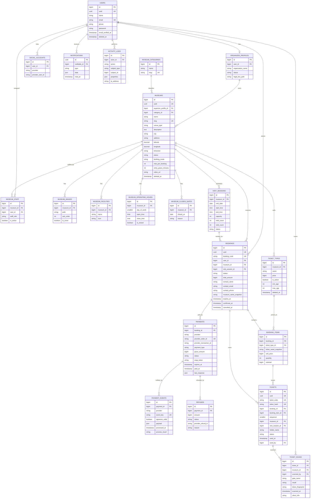

# ERD dan Perancangan Database

> Dokumen pendamping [`SYSTEM_DESIGN.md`](SYSTEM_DESIGN.md). Database: **PostgreSQL** (desain juga kompatibel MySQL 8 / MariaDB dengan penyesuaian kecil).

## 1. Prinsip Desain

| Prinsip | Penerapan |
|---|---|
| Primary key | `bigint` auto-increment (`id`) untuk relasi internal + kolom `uuid` (ULID/UUID) untuk URL publik agar ID tidak dapat ditebak |
| Uang | `bigint` dalam rupiah (tanpa desimal) **[REKOMENDASI]**; hindari float. Kolom `currency` default `IDR` |
| Waktu | `timestamptz` disimpan UTC; `date`/`time` untuk tanggal & jam kunjungan sesuai zona museum (`museums.timezone`) |
| Snapshot | Nama tiket, harga, nama museum disalin ke `booking_items`/`bookings` agar audit tetap benar |
| Soft delete | Hanya pada `users`, `museums`, `ticket_types` (`deleted_at`). Tabel transaksi (`bookings`, `payments`, `tickets`, `ticket_scans`) **tidak** di-soft-delete; gunakan status |
| Enum | Disimpan sebagai `string` + constraint `CHECK`/Enum PHP (lebih mudah dimigrasi dibanding ENUM native) |
| Perluasan | `museums` → generik: kolom `venue_type` (default `museum`) sehingga dapat menampung galeri/situs/event |

## 2. ERD (Mermaid)



> `FK` pada `tickets.used_by`, `ticket_scans.scanned_by`, `notifications.notifiable_id`, `activity_logs.actor_id` mengarah ke `users.id`. Tabel opsional (`reviews`, `wishlists`, `settings`) tidak digambar.

### Kardinalitas ringkas

| Relasi | Kardinalitas | Catatan |
|---|---|---|
| user → organizer_profile | 1 : 0..1 | Hanya user ber-role Organizer |
| organizer_profile → museums | 1 : N | Satu organizer boleh banyak museum |
| museum ↔ user (staff) | N : M via `museum_staff` | `staff_role`: owner / manager / gate_staff |
| museum → ticket_types / visit_sessions | 1 : N | |
| visit_session → bookings | 1 : N | Banyak booking berbagi satu kapasitas |
| booking → booking_items | 1 : 1..N | |
| booking_item → tickets | 1 : quantity | Satu baris item jumlah N menghasilkan N tiket |
| booking → payments | 1 : 0..N | Bayar ulang bila percobaan sebelumnya gagal/kedaluwarsa (order_id baru) |
| payment → payment_events | 1 : N | Setiap callback dicatat |
| ticket → ticket_scans | 1 : N | Termasuk percobaan gagal |

## 3. Spesifikasi Tabel

Notasi: **PK** primary key · **FK** foreign key · **UQ** unique · **NN** not null · **idx** index.

### 3.1 Akun dan akses

**users** — akun semua role. Role global (Admin/Organizer/User) dikelola **sepenuhnya** oleh paket permission (`roles`, `permissions`, `model_has_roles`, `model_has_permissions`, `role_has_permissions` dari `spatie/laravel-permission`). Tidak ada kolom role di `users`.
| Kolom | Tipe | Aturan |
|---|---|---|
| id | bigint | PK |
| uuid | uuid | UQ, NN |
| name | varchar(120) | NN |
| email | varchar(190) | UQ, NN (UQ pada email ter-lower; untuk soft delete gunakan partial unique `WHERE deleted_at IS NULL`) |
| phone | varchar(30) | null |
| password | varchar | null untuk akun sosial murni |
| email_verified_at | timestamptz | null |
| deleted_at | timestamptz | null (soft delete) |
Index: `email`, `deleted_at`.

**organizer_profiles** — data badan/pengelola. FK `user_id` → users (UQ). Kolom: `organization_name` NN, `contact_phone`, `legal_doc_path` null, `status` (`pending`/`approved`/`suspended`) NN, `approved_by` FK users null, `approved_at`.

**museum_staff** — keanggotaan per museum. FK `museum_id`, FK `user_id`; `staff_role` (`owner`/`manager`/`gate_staff`) NN; `is_active` bool. **UQ (museum_id, user_id)**. Dipakai Policy untuk kepemilikan akses.

**social_accounts** (lanjutan) — FK `user_id`; `provider` (`google`/`facebook`/`tiktok`), `provider_user_id`. **UQ (provider, provider_user_id)**. Token disimpan terenkripsi hanya bila benar-benar diperlukan.

### 3.2 Data museum

**museum_categories** — master kategori. `name` NN, `slug` UQ, `parent_id` FK null (hierarki opsional), `is_active`.

**museums** — entitas utama venue.
| Kolom | Tipe | Aturan |
|---|---|---|
| organizer_profile_id | bigint | FK NN |
| category_id | bigint | FK NN |
| name, slug | varchar | NN, slug UQ |
| venue_type | varchar(30) | default `museum` (perluasan) |
| description | text | |
| address, city, province | varchar | city di-index untuk filter |
| latitude / longitude | decimal(10,7) | null; CHECK rentang |
| timezone | varchar(40) | default `Asia/Jakarta` |
| status | varchar | `draft`/`pending_review`/`approved`/`rejected`/`archived` |
| booking_mode | varchar | `daily` (satu sesi per hari) / `slot` |
| max_per_booking | smallint | default 10 |
| entry_grace_minutes | smallint | default 15 |
| video_url | varchar | YouTube; divalidasi di backend |
| deleted_at | timestamptz | soft delete |
Index: `slug` UQ, `(status, city)`, `(category_id, status)`.

**museum_images** — FK `museum_id`; `path`, `caption`, `sort_order`, `is_cover`. Index `(museum_id, sort_order)`.
**museum_facilities** — FK `museum_id`; `name`, `icon`. (Bila daftar fasilitas ingin dibakukan, ubah menjadi master `facilities` + pivot; MVP cukup sederhana.)
**museum_operating_hours** — FK `museum_id`; `day_of_week` (0–6), `open_time`, `close_time`, `is_closed`. **UQ (museum_id, day_of_week)**.
**museum_closed_dates** — FK `museum_id`; `closed_on` date, `reason`. **UQ (museum_id, closed_on)**.

### 3.3 Tiket, jadwal, dan kuota

**ticket_types** — jenis dan harga. FK `museum_id`; `name` NN, `description`, `price` bigint NN (≥ 0), `is_active`, `min_age`/`max_age` null, `sort_order`, `deleted_at`. Index `(museum_id, is_active)`.
> *Perubahan harga terjadwal* (`ticket_prices`) ditunda ke tahap lanjutan; di MVP harga diubah langsung dan booking lama aman karena snapshot.

**visit_sessions** — **inti kuota**. Satu baris = satu museum + tanggal + slot.
| Kolom | Tipe | Aturan |
|---|---|---|
| museum_id | bigint | FK NN |
| visit_date | date | NN |
| start_time / end_time | time | null bila `booking_mode = daily` |
| capacity | int | NN, ≥ 0 |
| held_count | int | NN, default 0, ≥ 0 — kuota ditahan (booking pending) |
| sold_count | int | NN, default 0, ≥ 0 — kuota terjual (booking confirmed) |
| status | varchar | `open`/`closed`/`cancelled` |
Constraint: **UQ (museum_id, visit_date, start_time)** (gunakan `COALESCE` / unique index ekspresi di PostgreSQL agar `NULL` tidak dianggap berbeda); **CHECK (held_count + sold_count <= capacity)**; CHECK `held_count >= 0 AND sold_count >= 0`. Index `(museum_id, visit_date)`.

> **[REKOMENDASI]** Kuota di level sesi (kapasitas museum per slot), bukan per jenis tiket, agar sederhana dan sesuai kapasitas fisik ruang. Batas per jenis tiket (`ticket_type_limits`) bisa ditambahkan kelak.

### 3.4 Pemesanan dan pembayaran

**bookings** — transaksi pemesanan.
| Kolom | Tipe | Aturan |
|---|---|---|
| uuid, booking_code | | UQ; booking_code mudah dibaca (mis. `LWG-8F3K2A`) |
| user_id | bigint | FK NN |
| museum_id, visit_session_id | bigint | FK NN |
| status | varchar | lihat SYSTEM_DESIGN §11.2 |
| total_amount | bigint | NN |
| contact_name, contact_email, contact_phone | | NN (snapshot pemesan) |
| museum_name_snapshot, visit_date_snapshot, slot_label_snapshot | | untuk audit |
| expires_at | timestamptz | batas bayar |
| confirmed_at, cancelled_at, expired_at | timestamptz | null |
Index: `(user_id, created_at)`, `(museum_id, status)`, `(status, expires_at)` (untuk job expire), `visit_session_id`.

**booking_items** — FK `booking_id`, FK `ticket_type_id`; `ticket_name_snapshot`, `unit_price`, `quantity` (≥ 1), `subtotal`. Index `booking_id`.

**payments** — satu percobaan pembayaran.
Kolom: FK `booking_id`; `provider` (`midtrans`); **`provider_order_id` UQ** (mis. `{booking_code}-{attempt}`); `provider_transaction_id` null; `payment_type`; `gross_amount` (harus = `bookings.total_amount`); `status`; `snap_token` null; `snap_redirect_url`; `expires_at`; `paid_at`; `last_response` json (ringkas, tanpa data kartu). Index `booking_id`, `(status, expires_at)`.

**payment_events** — jejak setiap callback/polling, **kunci idempotensi**. FK `payment_id` (null bila order tak dikenal); `provider`; **`event_key` UQ** = hash(`order_id|transaction_status|status_code|gross_amount|transaction_id`) atau `transaction_id|status`; `signature_valid` bool; `payload` json; `process_result` (`applied`/`ignored_duplicate`/`rejected_signature`/`amount_mismatch`/`unknown_order`); `processed_at`.

**refunds** (lanjutan; tabel boleh dibuat nanti) — FK `payment_id`; `amount`, `status`, `provider_refund_id`, `reason`, `requested_by`, `processed_at`.

### 3.5 E-ticket dan gate

**tickets** — satu tiket = satu QR.
| Kolom | Tipe | Aturan |
|---|---|---|
| uuid | uuid | UQ |
| ticket_code | varchar(16) | UQ, kode pendek yang bisa diketik petugas (acak, tanpa karakter ambigu) |
| token_hash | char(64) | **UQ**; `sha256(token)`. Fungsinya sebagai **kunci pencarian cepat** saat scan (scanner mengirim token → server hash → cari). Token asli **tidak disimpan** |
| booking_id, booking_item_id | bigint | FK NN |
| sequence | smallint | NN, urutan tiket dalam satu `booking_item` (1..quantity). **UQ (booking_item_id, sequence)** mencegah tiket ganda saat proses konfirmasi diulang |
| museum_id, visit_session_id | bigint | FK NN (didenormalisasi untuk validasi scan cepat) |
| holder_name | varchar | null |
| status | varchar | `issued`/`used`/`void` |
| used_at, used_by | | null; `used_by` FK users |
Index/constraint: `token_hash` UQ, `ticket_code` UQ, `(booking_item_id, sequence)` UQ, `(museum_id, visit_session_id, status)`, `booking_id`.
Konsekuensi menyimpan hash saja: e-ticket dirender ulang dari token yang **dihitung ulang via HMAC** (lihat §5), bukan dibaca dari database.

**ticket_scans** — setiap percobaan scan (valid maupun gagal). FK `ticket_id` null (token tidak dikenal), `museum_id`, `scanned_by` FK users; `gate_name`; `result`; `token_fingerprint` (8 char pertama hash, bukan token); `scanned_at`; `client_info` (UA/perangkat). Index `(museum_id, scanned_at)`, `ticket_id`.

### 3.6 Pendukung

**notifications** — tabel standar Laravel (`database` channel).
**activity_logs** — `actor_id` null (sistem), `action`, `subject_type/id`, `properties` json (nilai lama/baru), `ip_address`, `created_at`. Index `(subject_type, subject_id)`, `(actor_id, created_at)`.
**settings** — key/value konfigurasi platform (mis. `payment_expiry_minutes`).
**reviews**, **wishlists** — opsional (tahap lanjutan/opsional).

## 4. Aturan Nullable / Unique / Foreign Key

- Semua FK: `ON DELETE RESTRICT` untuk tabel transaksi (`bookings`, `payments`, `tickets`, `ticket_scans`) agar audit utuh; `ON DELETE CASCADE` hanya untuk anak murni konten (`museum_images`, `museum_facilities`, `museum_operating_hours`, `museum_closed_dates`).
- Unique penting: `users.email`, `museums.slug`, `payments.provider_order_id`, `payment_events.event_key`, `tickets.token_hash`, `tickets.ticket_code`, `bookings.booking_code`, `museum_staff(museum_id,user_id)`, `visit_sessions(museum_id,visit_date,start_time)`.
- Kolom snapshot **NN**, kolom referensi (`ticket_type_id`) tetap FK agar laporan per jenis tiket bisa dibuat.

## 5. Token QR (rancangan)

1. Saat menerbitkan tiket, `ticket.uuid` dibuat dengan CSPRNG (UUID v4/ULID acak).
2. Token dihitung dari uuid (langkah 3); simpan hanya `token_hash`; **jangan simpan token asli**.
3. **Keputusan: token diturunkan via HMAC** (bukan acak murni): `token = base64url(HMAC_SHA256(APP_TICKET_SECRET, ticket.uuid))`. Server dapat menghitung ulang token untuk menampilkan e-ticket, tetapi pihak luar tidak dapat menebaknya tanpa secret. `token_hash = sha256(token)` disimpan hanya untuk **lookup saat scan**. Versi secret ditandai prefix (`MT1.` = secret v1); rotasi secret = terbitkan prefix baru dan terima prefix lama selama masa transisi. **Secret tidak boleh masuk repo.**
4. Isi QR = `MT1.{token}` (tanpa data pribadi). Scanner hanya mengirim string itu.

## 6. Mencegah Overbooking

### 6.1 Strategi: update kondisional atomik dalam transaksi

Saat membuat booking (satu transaksi DB):

```sql
-- 1) Tahan kuota secara atomik. Hanya berhasil jika masih cukup.
UPDATE visit_sessions
   SET held_count = held_count + :qty, updated_at = now()
 WHERE id = :session_id
   AND status = 'open'
   AND (held_count + sold_count + :qty) <= capacity;
-- affected rows = 0  => kuota habis (abort, tampilkan pesan).
-- affected rows = 1  => lanjut buat bookings + booking_items + payments.
```

Mengapa aman: PostgreSQL mengunci baris saat `UPDATE`; dua transaksi untuk kuota terakhir diserialisasi — yang kedua melihat nilai terbaru, kondisi `WHERE` gagal, `affected rows = 0`. `CHECK (held_count + sold_count <= capacity)` adalah **sabuk pengaman terakhir** di level database.

Alternatif setara: `SELECT ... FOR UPDATE` pada baris `visit_sessions` lalu hitung di aplikasi (lebih verbose, perlu `DB::transaction` + `lockForUpdate()` di Laravel). Dipilih update kondisional karena lebih sederhana dan lebih sedikit waktu lock.

Catatan: jangan hitung sisa kuota dari `COUNT(tickets)` pada saat checkout (rawan race condition); counter di `visit_sessions` adalah sumber kebenaran dan direkonsiliasi harian terhadap `SUM(booking_items.quantity)`.

### 6.2 Siklus kuota

| Peristiwa | Aksi pada `visit_sessions` | Aksi pada booking |
|---|---|---|
| Checkout dimulai | `held_count += qty` (jika cukup) | `pending_payment`, `expires_at = now + N menit` |
| Pembayaran **paid** | `held_count -= qty`, `sold_count += qty` (satu transaksi) | `confirmed`, tiket diterbitkan |
| Pembayaran gagal/kedaluwarsa/cancel | `held_count -= qty` | `expired`/`cancelled` |
| Refund (lanjutan) | `sold_count -= qty` (bila kebijakan mengizinkan kuota kembali) | `refunded`, tiket `void` |
| Pembayaran terlambat setelah `expired` | Coba `held_count += qty → sold_count` jika cukup, bila tidak antrean refund | lihat SYSTEM_DESIGN §11.3 |

### 6.3 Pengembalian kuota idempoten

Gunakan guard status, bukan "ingat sudah dikembalikan":

```sql
-- Dalam satu transaksi
UPDATE bookings SET status = 'expired', expired_at = now()
 WHERE id = :id AND status = 'pending_payment' AND expires_at <= now();
-- Hanya jika affected rows = 1:
UPDATE visit_sessions SET held_count = held_count - :qty WHERE id = :session_id;
```

Dengan demikian job scheduler yang berjalan dua kali atau webhook `expire` yang datang bersamaan tidak mengembalikan kuota dua kali.

### 6.4 Konfirmasi pembayaran idempoten

1. Simpan callback ke `payment_events` dengan `event_key` UQ; jika konflik → duplikat, balas 200 tanpa proses ulang.
2. Dalam transaksi: kunci baris `bookings` (`FOR UPDATE`), cek status masih `pending_payment`, `gross_amount` cocok, lalu pindahkan kuota held→sold, set `confirmed`, buat tiket.
3. Tiket dibuat dengan batas unik (`booking_item_id` + nomor urut) agar proses ulang tidak membuat tiket ganda.

## 7. Strategi Soft Delete

| Tabel | Soft delete | Alasan |
|---|---|---|
| users | Ya + anonimisasi data pribadi | Akun dapat dihapus, transaksi tetap |
| museums, ticket_types | Ya (`archived`/`deleted_at`) | Booking lama masih mereferensikan |
| bookings, payments, tickets, scans, payment_events | Tidak | Audit |
| museum_images/facilities/hours/closed_dates | Hard delete | Konten ringan |

## 8. Contoh Data

**museums**: `id=1, name="Museum Batik Nusantara", booking_mode="slot", status="approved"`
**ticket_types**: `(id=1, museum_id=1, "Dewasa", 25000)`, `(id=2, museum_id=1, "Pelajar", 10000)`
**visit_sessions**: `(id=10, museum_id=1, 2026-12-20, 09:00–11:00, capacity=100, held=2, sold=48)`

User Rina memesan 2 Dewasa + 1 Pelajar untuk sesi 10:
- `bookings`: `id=500, code=LWG-8F3K2A, status=pending_payment, total=60000, expires_at=+30m`; `visit_sessions.held_count` 2 → 5.
- `booking_items`: `(500, type=1, "Dewasa", 25000, qty=2, 50000)`, `(500, type=2, "Pelajar", 10000, qty=1, 10000)`.
- `payments`: `order_id=LWG-8F3K2A-1, gross_amount=60000, status=pending`.
- Setelah bayar: `payments.status=paid`, `bookings.status=confirmed`, sesi `held=2, sold=51`, dan 3 baris `tickets` (`status=issued`).
- Saat scan pertama tiket #1: `tickets.status=used`; `ticket_scans.result=valid`. Scan kedua: `ticket_scans.result=already_used` (status tetap `used`).

## 9. Validasi Scan (rujukan implementasi)

### 9.1 Aturan jendela waktu

Semua perbandingan memakai **waktu lokal museum** (`museums.timezone`), bukan waktu server.

| Mode | Jendela valid | `not_yet_valid` | `expired` |
|---|---|---|---|
| `daily` | Sepanjang `visit_date` | `visit_date` > hari ini | `visit_date` < hari ini |
| `slot` | `[start_time - grace, end_time]` pada `visit_date` | Sebelum `start_time - grace` | Setelah `end_time`, atau `visit_date` lewat |

`grace = museums.entry_grace_minutes` (default 15). **[REKOMENDASI]** pengunjung boleh masuk lebih awal sebesar toleransi dan boleh terlambat selama slot belum berakhir. Ubah bila museum memiliki kebijakan lain.

### 9.2 Urutan pemeriksaan (di service `ScanValidator`)

1. Dekode token; prefiks tidak dikenal atau format salah → `invalid`.
2. `token_hash = sha256(token)`; cari tiket (join `visit_sessions` dan `museums`). Tidak ada → `invalid`.
3. `tickets.museum_id != museum petugas` → `wrong_museum` (tiket **tidak** diubah).
4. `status = void` → `void`.
5. `status = used` → `already_used` (sertakan `used_at` dan nama petugas).
6. Hitung `now_local` dan terapkan tabel 9.1 → `not_yet_valid` / `expired`.
7. Semua lolos → jalankan **update atomik** (9.3).

Semua hasil, termasuk gagal, dicatat ke `ticket_scans` (insert-only).

### 9.3 Update atomik (penentu akhir, mencegah double scan)

```sql
UPDATE tickets
   SET status = 'used', used_at = now(), used_by = :staff_id, updated_at = now()
 WHERE id = :ticket_id
   AND status = 'issued';
-- affected rows = 1  => hasil VALID
-- affected rows = 0  => ada scan lain yang menang lebih dulu:
--                       baca ulang tiket, hasil = already_used
```

Pemeriksaan di langkah 3-6 bersifat *fail-fast* untuk pesan yang tepat; **kebenaran** dijamin oleh klausa `WHERE status = 'issued'` pada langkah 9.3, sehingga dua scan bersamaan tidak mungkin sama-sama `valid`.

### 9.4 Scan ulang akibat timeout jaringan

Jika scanner mengirim ulang token yang sama dari perangkat/petugas yang sama dalam jendela singkat (mis. 10 detik) dan tiket sudah `used` oleh scan tersebut, API mengembalikan `already_used` dengan penanda `recent_same_device = true`, sehingga UI dapat menampilkan "baru saja dipindai" tanpa memunculkan alarm palsu.
