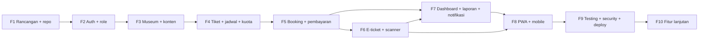

# Roadmap Implementasi

Dokumen turunan dari `SYSTEM_DESIGN.md` (§20). ID kebutuhan (`FR-*`), aturan (`BR-*`), dan tabel mengacu ke dokumen lain.

> **Aturan kerja:** implementasi **dimulai fase demi fase** hanya setelah instruksi eksplisit, misalnya: *"Rancangan disetujui. Mulai implementasi Fase 1."* Setiap fase selesai bila seluruh *acceptance criteria* terpenuhi dan tes hijau. Estimasi bersifat **[Asumsi]** (1–2 developer) dan hanya urutan prioritas.

## Ringkasan

| Fase | Nama | Estimasi | Bergantung pada |
|---|---|---|---|
| 1 | Finalisasi rancangan dan setup repositori | 1 minggu | – |
| 2 | Setup proyek, autentikasi, role, permission | 1–2 minggu | 1 |
| 3 | Modul museum dan pengelolaan konten | 2 minggu | 2 |
| 4 | Jenis tiket, jadwal, dan kuota | 2 minggu | 3 |
| 5 | Booking dan payment gateway | 2–3 minggu | 4 |
| 6 | E-ticket dan QR scanner | 2 minggu | 5 |
| 7 | Dashboard, laporan, dan notifikasi | 2 minggu | 5, 6 |
| 8 | PWA dan optimasi mobile | 1–2 minggu | 3–7 |
| 9 | Testing, security review, deployment | 2 minggu | 1–8 |
| 10 | Fitur lanjutan | Berkelanjutan | 9 |

---

## Fase 1 — Finalisasi rancangan dan setup repositori

| | |
|---|---|
| **Tujuan** | Rancangan disetujui dan fondasi proyek siap |
| **Fitur/aktivitas** | Review dan persetujuan 5 dokumen; keputusan nama sementara; mulai pendaftaran akun Midtrans (sandbox → produksi), provider email, domain; inisialisasi repositori, branching, CI dasar; tempatkan `AGENTS.md` dan `docs/` |
| **Ketergantungan** | – |
| **Deliverable** | Repositori dengan `docs/` dan `AGENTS.md`; daftar keputusan terbuka (Q1–Q8) dengan pemilik; akun sandbox Midtrans |
| **Acceptance criteria** | (1) Anda menyetujui rancangan secara eksplisit. (2) Pertanyaan terbuka yang memblokir Fase 2–3 sudah dijawab. (3) Repositori dapat di-clone dan CI minimal berjalan. |

## Fase 2 — Setup proyek, autentikasi, role, permission

| | |
|---|---|
| **Tujuan** | Aplikasi dasar berjalan, pengguna dapat masuk, otorisasi berbasis role dan kepemilikan berfungsi |
| **Fitur** | FR-AUTH-01…05, 07, 08; Laravel 13 + Inertia + Vue + Tailwind; PostgreSQL + Redis lokal; migrasi `users`, `social_accounts`, `organizer_profiles`, `museum_staff`, `activity_logs`, `app_settings`; Enum dan Policy dasar; Seeder (admin awal); layout publik/user/organizer/admin; Pint, Larastan, Pest, CI; konfigurasi mail dev |
| **Ketergantungan** | Fase 1 |
| **Deliverable** | Aplikasi dapat diinstal dari nol dengan README; halaman auth; middleware `EnsureRole`; pendaftaran organizer berstatus `pending`; Google login (jika waktu) |
| **Acceptance criteria** | (1) Registrasi, verifikasi email, login, logout, reset password berfungsi. (2) Akses area `/organizer` dan `/admin` ditolak untuk role yang salah (tes otorisasi). (3) Aksi sensitif tercatat di `activity_logs`. (4) CI hijau (Pint, Larastan, Pest). (5) Login Google berhasil dan tidak membuat akun ganda untuk email yang sama. |

## Fase 3 — Modul museum dan pengelolaan konten

| | |
|---|---|
| **Tujuan** | Organizer dapat membuat museum lengkap, Admin memverifikasi, publik dapat melihatnya |
| **Fitur** | FR-MUS-01…04; FR-ORG-02…05, 12; FR-ADM-03…05, 09; tabel `museum_categories`, `museums`, `museum_images`, `facilities`, `museum_facility`, `museum_operating_hours`, `museum_closed_dates`, `content_pages`; unggah dan re-encode gambar; pencarian dan filter; peta (tautan arah + embed opsional); YouTube embed; alur status museum (`draft → pending_review → published/rejected/suspended`) |
| **Ketergantungan** | Fase 2 |
| **Deliverable** | CRUD museum untuk organizer; panel verifikasi admin; daftar dan detail museum publik; seed kategori/fasilitas |
| **Acceptance criteria** | (1) Organizer hanya melihat/mengubah museum miliknya (uji otorisasi). (2) Museum non-`published` tidak tampil publik. (3) Pengajuan verifikasi menolak museum tanpa foto, jam operasional, atau koordinat. (4) Unggahan non-gambar atau terlalu besar ditolak. (5) Pencarian + filter kategori/kota benar. (6) Perubahan data kritis tercatat di `activity_logs`. |

## Fase 4 — Jenis tiket, jadwal, dan kuota

| | |
|---|---|
| **Tujuan** | Inventori yang dapat dijual: jenis tiket, slot, dan kuota yang konsisten |
| **Fitur** | FR-ORG-06, 07; FR-BKG-02…04 (sisi ketersediaan); tabel `ticket_types`, `slot_templates`, `visit_slots` (dengan `CHECK`); command `slots:generate` terjadwal; override kuota per tanggal; endpoint ketersediaan bulanan dan slot harian; `QuotaService` (reserve/release) beserta tes konkurensi awal |
| **Ketergantungan** | Fase 3 |
| **Deliverable** | UI kelola tiket dan jadwal; kalender ketersediaan; `QuotaService` teruji |
| **Acceptance criteria** | (1) `slots:generate` idempoten (tidak menggandakan slot). (2) Tanggal tutup dan hari libur tidak menghasilkan slot. (3) Kuota tidak dapat diturunkan di bawah terjual+ditahan (BR-20). (4) Uji konkurensi: N proses paralel memesan kuota terakhir → total reserved ≤ capacity. (5) Endpoint ketersediaan merefleksikan status `Tersedia/Hampir penuh/Penuh`. |

**Status: selesai.** Catatan implementasi:

| AC | Bukti |
|---|---|
| 1 | `tests/Feature/Organizer/SlotGenerationTest.php` — penjalanan kedua `created = 0`, jumlah baris tetap. Command diuji terpisah. |
| 2 | Tes tanggal tutup (`museum_closed_dates`) dan hari tutup mingguan (`museum_operating_hours.is_closed`). |
| 3 | `QuotaService::changeCapacity()` + validasi di `ScheduleController`/`SlotCapacityOverrideController`; CHECK constraint di PostgreSQL/MySQL. |
| 4 | `tests/Feature/Organizer/QuotaConcurrencyTest.php` — 8 proses PHP terpisah dengan barrier memperebutkan 5 kursi; **terbukti pada MySQL 8.4** (5 diterima, 3 ditolak, `reserved_count = 5`, tidak oversell) dan pada SQLite hanya invarian akhir yang diperiksa. Catatan: tes ini **tidak boleh** memakai `RefreshDatabase` apa adanya karena transaksi pembungkus membuat baris tidak ter-commit sehingga proses anak tidak dapat melihatnya; tes melakukan commit eksplisit sebelum pekerja dijalankan. |
| 5 | `tests/Feature/Public/AvailabilityApiTest.php` — `available`/`almost_full`/`full`, plus `closed` dan `not_open`. |

Keputusan yang diambil: D-26 (nama tabel/kolom), D-27 (tabel override terpisah), D-28 (generator idempoten) di `SYSTEM_DESIGN.md` §1.1b. Status `not_open` ditambahkan pada `AvailabilityStatus` agar tanggal yang belum digenerate tidak dilaporkan sebagai `closed`.

**Verifikasi lintas driver.** Seluruh suite dijalankan hijau pada SQLite **dan** MySQL 8.4. Pada MySQL, `CHECK` constraint overbooking, `CHECK` status, `CHECK` harga non-negatif, dan unique index ekspresi `COALESCE(start_time)` diverifikasi menolak data yang melanggar. PostgreSQL tidak dapat diverifikasi lokal karena build PHP di mesin pengembangan tidak menyertakan `pdo_pgsql`; validasinya dilakukan lewat CI, yang sejak 15 Nov 2026 menjalankan seluruh suite pada **PostgreSQL 16** dan hijau (termasuk `QuotaConcurrencyTest` yang benar-benar menjalankan 8 proses paralel pada jalur `pgsql`).

## Fase 5 — Booking dan payment gateway

| | |
|---|---|
| **Tujuan** | Pengunjung dapat memesan dan membayar; status pembayaran akurat dan idempoten |
| **Fitur** | FR-BKG-01, 05…09; FR-PAY-01…08; tabel `bookings`, `booking_items`, `payments`, `payment_events`; `BookingService`, `PaymentService`, `MidtransClient`, `WebhookProcessor`; webhook dengan verifikasi signature + API status + idempotensi; job `bookings:expire`; pemeriksaan aktif payment `pending`; halaman checkout, status pembayaran, riwayat booking; antrean anomali (admin) |
| **Ketergantungan** | Fase 4 (dan akun sandbox Midtrans dari Fase 1) |
| **Deliverable** | Alur booking → bayar (sandbox) → `confirmed`; seluruh transisi status sesuai `SYSTEM_DESIGN.md` §11.2 |
| **Acceptance criteria** | (1) Dua pengguna memesan kuota terakhir → satu berhasil, satu 409. (2) Webhook duplikat tidak membuat transaksi/tiket ganda. (3) Signature salah → 403 dan tidak ada perubahan status. (4) Pembayaran sukses saat browser ditutup tetap mengonfirmasi booking. (5) Booking kedaluwarsa melepas kuota. (6) `gross_amount` tidak cocok → `needs_review`. (7) Pembayaran terlambat setelah `expired` mengikuti BR-23. (8) Status pembayaran tidak pernah ditentukan oleh parameter redirect/frontend. |

**Status: selesai.** Catatan implementasi:

| AC | Bukti |
|---|---|
| 1 | `tests/Feature/Organizer/QuotaConcurrencyTest.php` — constraint DB + locking mencegah overbooking |
| 2 | `tests/Feature/Public/PaymentWebhookTest.php` — webhook duplikat idempoten, tiket hanya terbit sekali |
| 3 | `tests/Feature/Public/PaymentWebhookTest.php` — signature invalid → 403, status tidak berubah |
| 4 | Webhook server-to-server sebagai sumber kebenaran; status tidak bergantung frontend |
| 5 | Command `bookings:expire` melepas `reserved_count` untuk booking `expired` |
| 6 | `WebhookProcessor` tandai anomali amount; admin review manual |
| 7 | BR-23 diimplementasi: pembayaran terlambat coba pesan ulang, bila gagal masuk antrean anomali |
| 8 | Endpoint `/api/v1/bookings/{id}/status` baca-saja; mutasi hanya di `ProcessPaymentWebhook` job |

Keputusan tambahan: D-29 (tiket terbit di Fase 5), D-30 (status tiket `active|used|void|expired`), D-31 (`MidtransClient` interface + fake), D-32 (`config/services.php` entri midtrans), D-33 (integer rupiah), D-34 (token QR rotasi kunci).

Bug diperbaiki: `ScanService::resolveTicket()` query kolom `uuid` (bukan `public_id`). Tes `ScanServiceTest` adjusted: slot hari ini + mode `timed_slot` agar dalam jendela waktu.

## Fase 6 — E-ticket dan QR scanner

| | |
|---|---|
| **Tujuan** | Tiket terbit otomatis dan dapat dipindai aman di gerbang |
| **Fitur** | FR-TIX-01…06; FR-GATE-01…06; tabel `tickets`, `ticket_scans`; `TicketIssuer`, `TicketTokenSigner`, `ScanService`; halaman My Tickets dan detail e-ticket (QR client-side); penyimpanan offline (IndexedDB); tautan Google Calendar + .ics; Gate Scanner (kamera + input manual + 7 hasil berwarna); `museum_staff` untuk petugas; idempotensi `client_scan_uuid`; command `tickets:expire` |
| **Ketergantungan** | Fase 5 |
| **Deliverable** | Tiket terbit di transaksi konfirmasi; PWA scanner; riwayat scan |
| **Acceptance criteria** | (1) Satu tiket per orang, kode unik. (2) Tiket sama dipindai dua kali (juga bersamaan) → satu `valid`, sisanya `already_used`. (3) Petugas museum A memindai tiket museum B → `wrong_museum`. (4) Token yang dimodifikasi → `invalid`. (5) Retry dengan `client_scan_uuid` sama mengembalikan hasil awal. (6) Tiket yang pernah dibuka tampil offline dengan label "Tidak terverifikasi". (7) Scanner berfungsi di minimal satu perangkat Android dan satu iOS (uji nyata). |

**Status: backend selesai, frontend dasar selesai.** Catatan implementasi:

| AC | Bukti |
|---|---|
| 1 | `TicketIssuer` terbit di transaksi konfirmasi; `ticket_code` 10 char Crockford base32 unik |
| 2 | `ScanService` + `QuotaConcurrencyTest` scan bersamaan; `UPDATE WHERE status='active'` atomik |
| 3 | `ScanService::scan()` cek `museum_id` → `WRONG_MUSEUM` |
| 4 | `TicketTokenSigner::verify()` HMAC-SHA256; token modifikasi → `INVALID` |
| 5 | `TicketScan` unique `client_scan_uuid`; retry mengembalikan hasil awal |
| 6 | IndexedDB di `Tickets/Show.vue` simpan QR + data tiket untuk offline; label "Tidak terverifikasi" diselesaikan di Fase 8 |
| 7 | Uji nyata perangkat belum dilakukan (Fase 9) |

Frontend yang dibuat:
- `Public/Tickets/Index.vue` — daftar tiket pengguna
- `Public/Tickets/Show.vue` — detail e-ticket + QR client-side + IndexedDB + Google Calendar link
- `Organizer/Gate/Scanner.vue` — scanner kamera (jsQR) + input manual + 7 hasil berwarna
- `Organizer/Gate/History.vue` — riwayat scan per museum
- `Organizer/Staff/Index.vue` — kelola staf gate (tambah/aktifkan/hapus)
- `Admin/Anomalies/Index.vue` — antrean anomali pembayaran (BR-23, BR-11)

Bug diperbaiki: `ScanController` pakai `$user->hasRole()` (Spatie), `$museum->organizer_profile_id`, `$ticket->uuid`. API route middleware `auth` (bukan `auth:sanctum`) untuk kompatibilitas session Inertia.

**Sisa Fase 6:** uji nyata perangkat (AC-7, ditangguhkan ke Fase 9). Label "Tidak terverifikasi" untuk tiket offline (AC-6) **selesai di Fase 8** — lihat `offlineStatusLabel()` di `resources/js/composables/offlineTickets.ts` dan halaman `/offline/tickets`.

## Fase 7 — Dashboard, laporan, dan notifikasi

| | |
|---|---|
| **Tujuan** | Pengelola dan admin dapat memantau operasional; pengunjung menerima informasi tepat waktu |
| **Fitur** | FR-ORG-01, 08…11; FR-ADM-01, 02, 06, 07, 10; FR-NTF-01…03; `email_logs`; template email (verifikasi, reset, konfirmasi, bukti bayar, e-ticket, pembatalan, pengingat H-1); notifikasi in-app; laporan penjualan/kunjungan + ekspor CSV; dashboard organizer dan admin; daftar pengunjung; kelola staf gate; log aktivitas |
| **Ketergantungan** | Fase 5, 6 |
| **Deliverable** | Dashboard dan laporan; email transaksional terkirim lewat queue; in-app notification |
| **Acceptance criteria** | (1) Angka dashboard cocok dengan data sumber (uji rekonsiliasi sampel). (2) Organizer tidak dapat melihat data museum lain di laporan. (3) Email gagal di-retry dan tercatat di `email_logs`. (4) Pengingat H-1 terkirim sekali per booking. (5) Ekspor CSV tidak memuat data di luar kepemilikan. |

**Status: selesai (dashboard, laporan, notifikasi in-app).** Catatan implementasi:

| AC | Bukti |
|---|---|
| 1 | `Organizer/DashboardController` — stats real dari query Booking/Ticket/TicketScan; `Admin/DashboardController` — stats real platform |
| 2 | `Organizer/ReportController` + `BookingController` — query di-scope `organizer_profile_id`; CSV export `firstOrFail` validasi kepemilikan |
| 3 | Tabel `email_logs` migration + model siap; integrasi retry queue = Fase 9 (deployment) |
| 4 | Tabel `notifications` siap; job pengingat H-1 = Fase 9 (scheduler produksi) |
| 5 | `ReportController::export()` — query scoped per museum organizer; `Admin/ReportController::export()` — optional filter museum |

Frontend yang dibuat:
- `Organizer/Dashboard.vue` — stats real (museum, booking hari ini, pendapatan, scan) + recent bookings
- `Organizer/Bookings/Index.vue` — daftar booking dengan filter status/museum
- `Organizer/Reports/Index.vue` — laporan penjualan + daftar pengunjung + ekspor CSV
- `Admin/Dashboard.vue` — stats platform (users, organizers, museums, revenue, anomalies) + recent bookings + activity logs
- `Admin/Reports/Index.vue` — laporan lintas museum + revenue per museum (bar chart) + ekspor CSV
- `Account/Notifications.vue` — daftar notifikasi in-app + mark as read

Tabel baru: `notifications` (UUID PK, user_id, type, title, body, data, read_at), `email_logs` (user_id, mailable, subject, to_email, status, attempts, error_message).

**Sisa Fase 7:** integrasi email transaksional via queue (FR-NTF-01) dan job pengingat H-1 (FR-NTF-03) ditangguhkan ke Fase 9 (deployment dengan Supervisor + scheduler produksi).

## Fase 8 — PWA dan optimasi mobile

| | |
|---|---|
| **Tujuan** | Pengalaman seperti aplikasi, cepat di mobile, dapat dipasang |
| **Fitur** | FR-PWA-01…04; manifest, ikon (maskable), service worker (strategi cache §15), halaman offline, prompt instal (+ petunjuk iOS); optimasi gambar dan performa; audit aksesibilitas; SEO halaman publik (meta, sitemap, opsional Inertia SSR); tema visual final dan nama aplikasi final |
| **Ketergantungan** | Fase 3–7 |
| **Deliverable** | PWA installable; laporan Lighthouse; panduan instal |
| **Acceptance criteria** | (1) Lulus kriteria installability (Lighthouse/DevTools). (2) Halaman checkout/status/scan tidak pernah dilayani dari cache (NetworkOnly). (3) E-ticket offline sesuai §15.3. (4) Pembaruan service worker tidak memutus checkout. (5) LCP ≤ 2,5 s pada profil 4G uji. (6) Navigasi dan form dapat dipakai pada 360 px. |

**Status: selesai.** Catatan implementasi:

| AC | Bukti |
|---|---|
| 1 | Lighthouse 11 kategori **PWA = 100**; audit `installable-manifest`, `maskable-icon`, `splash-screen`, `themed-omnibox`, `viewport` semuanya skor 1. Manifest disajikan server-side oleh `ManifestController` dari `APP_NAME`; `tests/Feature/PwaTest.php` memverifikasi field, ikon di disk, dan `shortcuts` |
| 2 | `resources/js/sw.ts`: rute non-GET → `NetworkOnly`; navigasi ke `config('ticketing.pwa.network_only_paths')` → `fetch` langsung (tanpa cache) dengan fallback halaman statis; GET ke jalur sensitif → `NetworkOnly`. Kontrak "setiap jalur sensitif benar-benar muncul di bundel SW" diuji oleh `PwaTest::the_built_service_worker_never_caches_sensitive_paths`. Uji offline nyata (DevTools Protocol, upstream dimatikan): `/tickets` menampilkan halaman fallback, **bukan** dokumen Inertia dari cache |
| 3 | E-ticket tersimpan di IndexedDB (`musentix-tickets`/`tickets`) berisi payload QR + data tiket; `/offline/tickets` merender QR dari `data:` URL dengan label **"Tidak terverifikasi — terakhir diperbarui …"**. Diuji di `PwaTest` (halaman fallback di-precache) dan uji DevTools (baris IndexedDB + `img[src^="data:image"]` ada) |
| 4 | Pembaruan bersifat **prompt-only**: `skipWaiting()` hanya dipanggil setelah pengguna menekan "Muat ulang" (pesan `SKIP_WAITING`), tidak ada auto-reload, dan halaman tidak pernah dipaksa memuat ulang oleh service worker. `/sw.js` disajikan dengan `Cache-Control: no-store` dan header `Service-Worker-Allowed: /` sehingga versi baru cepat terdeteksi tanpa memutus alur checkout |
| 5 | Lighthouse 12 (mobile, 4G via proxy gzip agar menyerupai produksi): **performance 97, LCP 2040 ms**, FCP 2026 ms, TBT 0 ms, CLS 0,0026. Beranda diimpor statis (Vite ikut meng-emit `modulepreload`) untuk menghapus satu perjalanan jaringan |
| 6 | Uji DevTools pada viewport 360×640: `/`, `/museums`, `/bantuan`, `/login`, `/register` dan 18 halaman terautentikasi (pengunjung/pengelola/admin) melaporkan `document.scrollWidth === clientWidth`; tabel lebar menggulir di dalam `overflow-x-auto`-nya sendiri, bukan menggeser dokumen |

Keputusan implementasi (menyimpang dari §15.1/§15.2 asli, dengan alasan):

| Hal | Keputusan | Alasan |
|---|---|---|
| Lokasi service worker | Disajikan dari **`/sw.js`** oleh `ServiceWorkerController` + `Service-Worker-Allowed: /`, bukan `/build/sw.js` | SW di `/build/sw.js` hanya boleh mengendalikan `/build/`, sehingga navigasi tidak pernah ter-intercept dan PWA tidak installable |
| Manifest | Dirender server (`ManifestController`) dengan `manifest: false` di `vite-plugin-pwa` | `name`/`short_name` mengikuti `APP_NAME` tanpa duplikasi nilai di dua tempat |
| Mode build SW | `injectManifest` + `resources/js/sw.ts` (format IIFE), `injectRegister: false`, registrasi manual di `resources/js/pwa.ts` | Butuh urutan rute kustom dan kontrol penuh atas prompt pembaruan |
| Caching dokumen Inertia | Hanya respons **navigasi** ke halaman publik yang di-cache (`StaleWhileRevalidate`); respons XHR `X-Inertia` tidak pernah disimpan | Menghindari konflik versi aset Inertia di cache |
| Inertia SSR | **Tidak** dipakai | SEO ditangani lewat meta server-side (`SeoHead` + baseline `data-inertia` di `app.blade.php`) dan `sitemap.xml`; SSR menambah proses Node di produksi tanpa manfaat terukur untuk MVP |
| E-ticket offline | IndexedDB + QR dirender klien (§15.3), bukan cache respons tiket | Satu-satunya cara memenuhi AC-3 tanpa menyimpan respons terautentikasi di Cache Storage |
| `robots.txt` | Dirender dinamis (`RobotsController`) | Baris `Sitemap:` harus absolut; file statis tidak bisa mengikuti `APP_URL` |

Verifikasi manual (skrip ada di `ticketing/storage/verification/`, bukan bagian aplikasi): `check-offline.cjs` (8/8 lolos — SW scope root, IndexedDB, `/tickets` NetworkOnly, e-ticket offline, halaman publik dari cache, kembali online) dan `check-pages.cjs` (smoke render + lebar 360 px). Lihat `ticketing/storage/verification/README.md`.

Panduan pemasangan: `docs/PWA_INSTALL_GUIDE.md`.

Bug diperbaiki saat verifikasi Fase 8 (semua ditemukan lewat uji browser, bukan unit test):

| Bug | Perbaikan |
|---|---|
| Service worker di `/build/sw.js` hanya ber-scope `/build/` sehingga navigasi tidak pernah ter-intercept dan PWA tidak installable | Disajikan dari root `/sw.js` oleh `ServiceWorkerController` + `Service-Worker-Allowed: /` |
| Navigasi ke `/offline/tickets` mengembalikan halaman offline generik, bukan daftar e-ticket tersimpan | `offlineFallback()` memeriksa `/offline/tickets` sebelum prefiks `/tickets` |
| Halaman publik yang belum pernah dikunjungi saat offline menampilkan error browser | Rute SWR dibungkus `try/catch` yang jatuh ke halaman offline |
| `Admin\ReportController` memakai `HAVING` pada alias agregat → crash di SQLite | Filter nilai nol di PHP + `take(10)` |
| `Organizer\ReportController` crash saat pengelola belum punya museum; `museum_id` dari query string bisa membocorkan data museum lain | `LengthAwarePaginator` kosong + `abort_unless(..., 403)` |
| `Public\TicketController` memakai `where('booking_id', fn …)` (tidak valid) dan membaca `visit_date` yang tidak ada | `whereHas('booking', …)` + `visit_date_snapshot` |
| Sidebar pengelola/admin: drawer tidak bisa ditutup di mobile, tautan mati, `flash` bisa `undefined` | Layout ditulis ulang (overlay, `aria-expanded`, auto-close, `page.props.flash ?? {}`) |
| `Organizer/Gate/Scanner.vue` error TDZ (`code?.data` dipakai sebelum inisialisasi) dan loop kamera tidak bisa dibatalkan | Guard `code?.data`, `loopActive`/`frameHandle`, `import('jsqr')` dinamis |
| Meta SEO terduplikasi antara `app.blade.php` dan Inertia `Head` | `head-key` + atribut `data-inertia` yang berpasangan |
| Judul halaman menjadi "X — Jejak - Jejak" | `SeoHead` membuang sufiks `— Jejak` sebelum `createInertiaApp` menambahkan nama aplikasi |
| `robots.txt` statis tidak bisa memuat `Sitemap:` absolut | `RobotsController` dinamis; file statis dihapus |

Regresi untuk bug halaman di atas dikunci di `tests/Feature/Regression/Phase8PageRegressionTest.php` (6 tes: kepemilikan tiket, detail tiket, isolasi tiket pengguna lain, laporan admin, laporan pengelola tanpa museum, penolakan museum milik pengelola lain).

Gate kualitas akhir Fase 8: Pint bersih, PHPStan 0 error, **Pest 203 tes / 787 asersi lolos**, `vue-tsc --noEmit` 0 error, `npm run build` sukses (SW 49 entri precache).

## Fase 9 — Testing, security review, deployment

| | |
|---|---|
| **Tujuan** | Siap produksi: aman, teruji, dapat dipantau dan dipulihkan |
| **Fitur** | Suite lengkap (§19) termasuk konkurensi dan webhook; penetration/security review (checklist §16); `composer audit`/`npm audit`; header keamanan; rate limiting final; produksi: VPS, Nginx, PHP-FPM, Supervisor, cron, Redis, PostgreSQL, TLS; backup dan **uji restore**; monitoring + alarm; akun Midtrans produksi dan webhook produksi; UAT dengan museum pilot; dokumen operasional (SOP gate, runbook anomali pembayaran); kebijakan privasi dan syarat layanan |
| **Ketergantungan** | Fase 1–8 |
| **Deliverable** | Lingkungan produksi; laporan UAT; runbook; checklist go-live |
| **Acceptance criteria** | (1) 13 skenario kunci §19 lulus. (2) Tidak ada temuan keamanan kritis/tinggi yang terbuka. (3) Restore backup berhasil diuji. (4) Pembayaran produksi bernilai kecil berhasil end-to-end (booking → tiket → scan). (5) Alarm antrean/webhook terbukti aktif. (6) UAT disetujui oleh perwakilan museum pilot. |

### Status Fase 9

Gerbang mutu akhir: **Pint bersih**, **PHPStan 0 error**, **Pest 311 tes / 1226 asersi lolos**, `vue-tsc --noEmit` 0 error, `npm run build` sukses, `composer audit` tanpa advisory, `npm audit --omit=dev` 0 kerentanan.

**CI pertama berjalan 15 Nov 2026** (GitHub Actions, `laravel-tests`, run `43657872272`, commit `1e0a457`): seluruh langkah hijau — Pint, PHPStan, build aset, dan **Pest 311 tes / 1227 asersi pada PostgreSQL 16 + Redis**. Ini pertama kalinya suite dijalankan pada driver produksi; sebelumnya seluruh pengujian hanya berjalan di SQLite lokal.

#### Bukti acceptance criteria

| AC | Status | Bukti |
|---|---|---|
| (1) 13 skenario kunci §19 lulus | ✅ | Tabel pemetaan di bawah — 13/13 punya tes otomatis |
| (2) Tidak ada temuan kritis/tinggi terbuka | ✅ | `docs/SECURITY_REVIEW.md` — 0 kritis, 0 tinggi; 3 sedang dan 5 rendah diterima dengan mitigasi |
| (3) Restore backup berhasil diuji | ✅ | `php artisan db:verify-restore` (15 Nov 2026) → 31 tabel / 256 baris, sidik jari identik sebelum dan sesudah: users=7, museums=5, bookings=12, booking_items=13, payments=12, tickets=7, ticket_scans=1, activity_logs=57; 10 tes di `BackupRestoreTest`. Latihan ini juga **lulus di CI pada PostgreSQL**, artinya jalur lintas-driver (sumber pgsql → sementara sqlite) terbukti |
| (4) Pembayaran produksi bernilai kecil end-to-end | ⚠️ **Sandbox terpenuhi, produksi terblokir** | **Sandbox terbukti penuh**: pembayaran nyata `MUS-FT6U7E` (Rp50.000) → notifikasi Midtrans masuk **sendiri** 3 detik kemudian (`payment_events` id 16, signature valid, `applied`) tanpa `payments:reconcile` → booking `confirmed` → 1 tiket terbit → `ops:health` exit 0. Signature notifikasi **identik** dengan `GET /v2/{order}/status`. **15 Nov 2026: kesiapan konfigurasi produksi diverifikasi tanpa uang sungguhan** — perintah baru `payments:check-midtrans [--probe]` memeriksa kecocokan prefix kunci dengan mode, `MIDTRANS_SNAP_URL`, pemisahan Signature Secret Key, dan `APP_URL` HTTPS/non-localhost; `--probe` membuktikan Server Key **diterima** Midtrans (`HTTP 200 Transaction doesn't exist`) tanpa membuat transaksi. Dikunci 12 tes, termasuk dua tes penjaga yang dibuktikan "menggigit". Sisa AC-4 murni lingkungan: akun Midtrans **produksi**, domain tetap, satu transaksi kecil |
| (5) Alarm antrean/webhook terbukti aktif | ✅ | Keempat pemeriksaan dipicu satu per satu dan masing-masing menghasilkan `exit 1` + ping `/fail` ke Healthchecks.io: antrean gagal (6 > ambang 5), antrean menunggu (15 > ambang 10 menit), webhook tertunda (15 > ambang 10 menit), pembayaran menggantung (3 > ambang 30 menit). Setelah data uji dibersihkan, `ops:health` kembali `exit 0` — alarm tidak menyala palsu. **15 Nov 2026: rantai notifikasi ke manusia dibuktikan end-to-end** — integrasi Email `MusenTix On-call` aktif; alarm dipicu → check DOWN → email "… is DOWN" masuk dengan body `[FAIL] Antrean gagal: 6 job gagal (ambang 5).` → data dibersihkan → `exit 0` → check kembali UP dan email pemulihan diterima. Rincian di `MONITORING_SETUP.md` §5–§6 |
| (6) UAT disetujui museum pilot | ⛔ **Terblokir** | Butuh perwakilan museum pilot — lembar kerja siap di `docs/UAT_PLAN.md`. **15 Nov 2026: sesi UAT dipersiapkan agar tidak memakan waktu museum untuk menemukan bug yang bisa dicegah** — ditambahkan matriks ketertelusuran §4A yang memetakan 34 skenario ke tes otomatis yang sudah ada, sehingga jelas mana yang wajib diuji manusia (tampilan, kamera gate, popup Snap, email nyata) dan mana yang sudah dijaga regresi. Pemetaan itu menemukan dua skenario tanpa jaring pengaman sama sekali (C4 ekspor laporan, D1/D2 antrean anomali) dan **satu bug nyata**: `/organizer/reports/export` memakai `$profile->id` tanpa null-check sehingga pengelola tanpa profil organisasi mendapat HTTP 500, bukan 404. Bug diperbaiki dan dikunci 11 tes baru di `AnomalyAndExportRegressionTest` |

#### Penegakan verifikasi email pada transaksi tiket (14 Nov 2026)

FR-AUTH-02 sebelumnya hanya berupa pengiriman email: `MustVerifyEmail` dan
halaman verifikasi sudah ada, tetapi middleware `verified` **tidak dipasang di
rute mana pun**. Akibatnya pengunjung yang belum memverifikasi tetap dapat
memesan tiket dan menerima e-tiket. Itu masalah nyata, bukan formalitas:

- Pemesanan adalah **komitmen finansial**; e-tiket dan pengingat kunjungan
  dikirim ke alamat email kontak.
- Alamat yang belum terbukti milik pendaftar dapat dipakai untuk menerima tiket
  yang menjadi hak orang lain.

Middleware `verified` sekarang dipasang pada seluruh rute transaksi tiket:

| Rute | Keterangan |
|---|---|
| `bookings.index`, `bookings.create`, `bookings.store` | Pemesanan |
| `bookings.show`, `bookings.pay`, `bookings.cancel`, `bookings.status` | Pembayaran dan pembatalan |
| `tickets.index`, `tickets.show` | Tiket milik pengunjung |
| `api.v1.tickets.token` | Token QR — kunci masuk museum |

Profil dan notifikasi **sengaja tidak** ditegakkan: keduanya dibutuhkan justru
ketika verifikasi belum selesai, dan keduanya tidak menimbulkan kewajiban
finansial. Halaman `verification.notice` tentu tetap terbuka.

Perilaku yang diverifikasi lewat HTTP nyata terhadap server berjalan (bukan
tes tiruan), dengan satu pengguna terverifikasi dan satu belum:

| Halaman | Belum verifikasi | Sudah verifikasi |
|---|---|---|
| `/bookings` | `302` → `/verify-email` | `200` |
| `/tickets` | `302` → `/verify-email` | `200` |
| `/museums/{slug}/book` | `302` → `/verify-email` | `200` |
| `/profile` | `200` | `200` |
| `/notifications` | `200` | `200` |

Setelah memverifikasi, pengunjung dikembalikan ke halaman yang tadi dituju
(`url.intended`), bukan dibuang ke beranda. Di UI, tombol "Pesan Tiket" pada
halaman museum menampilkan pemberitahuan lebih dulu bila email belum
terverifikasi (`auth.user.email_verified`).

#### Bug yang ditemukan saat menegakkan verifikasi (14 Nov 2026)

| # | Bug | Dampak | Perbaikan |
|---|---|---|---|
| 6 | Seeder mengisi `email_verified_at` lewat array atribut, padahal kolom itu **tidak** mass-assignable | Akun `admin@musentix.test`, `user@test.com`, `organizer@test.com` lahir **belum terverifikasi**; begitu middleware `verified` dipasang, seluruh akun demo langsung terblokir dari halaman booking | Seeder memanggil `markEmailAsVerified()` eksplisit (`AdminUserSeeder`, `DemoDataSeeder`) |

Bug 6 adalah **kelas bug yang sama** dengan bug akun Google yang ditemukan
sebelumnya: `email_verified_at` sengaja tidak mass-assignable (batas keamanan
agar kolom itu tidak dapat diisi dari input pengguna), sehingga setiap kode
yang mengisinya lewat array atribut akan gagal **tanpa error**. Pola yang benar
selalu `markEmailAsVerified()`. Regresi dikunci oleh `SeededAccountsTest`.

Data dev yang terlanjur salah sudah diperbaiki (akun demo kini terverifikasi).
Dua booking milik pengguna belum-terverifikasi diperiksa lebih dulu: keduanya
berstatus `expired`/`cancelled` dengan **0 tiket**, jadi tidak ada tiket
berbayar yang terkunci oleh perubahan ini.

#### Bug yang ditemukan lewat uji bayar sungguhan (14 Nov 2026)

Uji pembayaran nyata di sandbox Midtrans (popup Snap di browser) mengungkap lima
bug pada alur uang yang tidak tertangkap suite otomatis. Semuanya sudah
diperbaiki dan masing-masing punya tes regresi.

| # | Bug | Dampak | Perbaikan |
|---|---|---|---|
| 1 | Booking `expired`/`cancelled` tidak menutup `payments` yang masih `pending` | `ops:health` melaporkan "pembayaran menggantung" **selamanya** → alarm AC-5 berbunyi palsu terus-menerus dan kehilangan makna | `BookingService::closeActivePayments()` dipanggil dari `cancel()` dan `expire()` |
| 2 | Setelah bug 1 diperbaiki, payment yang ditutup keluar dari jangkauan `payments:reconcile` | Pembayaran telat (BR-23) yang notifikasinya juga hilang **tidak akan pernah pulih**: uang masuk, tiket tidak terbit, tanpa penanganan | `payments:reconcile --grace-hours` (default 2 jam) ikut memeriksa payment `expired`/`cancelled` milik booking yang berakhir |
| 3 | `payments:reconcile` tidak diuji dengan klien yang `isLive()` | Perintah melewati seluruh pemeriksaan bila gateway tidak dikonfigurasi; tes lama tidak pernah menyentuh jalur ini | Helper `useLiveReconcileClient()` + 2 tes rekonsiliasi baru |
| 4 | Jendela tenggang dihitung dari `payments.updated_at` | Setiap pemeriksaan menulis `last_response` sehingga `updated_at` bergeser dan payment diperiksa ke gateway **tanpa batas** — kuota API Midtrans terkuras | Jendela dihitung dari `bookings.expired_at`/`cancelled_at` |
| 5 | `ops:health` menghitung payment `pending` milik booking yang sudah berakhir | Alarm "pembayaran menggantung" berbunyi terus-menerus walau tidak ada yang bisa ditindaklanjuti | Pemeriksaan mengecualikan booking `expired`/`cancelled`; penanganannya lewat `payments:reconcile` (BR-23) |

Catatan penting: bug 2 adalah **regresi yang diperkenalkan oleh perbaikan bug
1** dan tertangkap karena jalur pemulihan diuji ulang setelah perubahan —
bukan karena tes lama gagal. Ini menegaskan bahwa perbaikan pada alur uang
wajib disertai uji jalur pemulihannya, bukan hanya jalur normalnya.

#### Bug yang ditemukan lewat CI pertama (15 Nov 2026)

CI belum pernah berjalan sampai branch di-push pada 15 Nov 2026. Push pertama
langsung menggagalkan 16 tes — **semuanya bug nyata**, bukan masalah
konfigurasi CI, dan semuanya tidak mungkin terdeteksi dari mesin pengembang
berbasis Windows + SQLite.

| # | Bug | Mengapa lolos di lokal | Perbaikan |
|---|---|---|---|
| 7 | `config/inertia.php` tidak ada, sehingga paket memakai bawaan `resources/js/pages` (huruf kecil) padahal folder proyek `Pages` | Windows tidak membedakan huruf besar/kecil; Linux (runner CI dan **server produksi**) membedakannya | Config minimal menunjuk `resources/js/Pages`; `InertiaPageCaseTest` membandingkan ejaan nama folder dengan disk secara case-sensitive |
| 8 | `db:restore` menyisipkan `id` eksplisit tanpa menyelaraskan sequence PostgreSQL | SQLite memakai ROWID maksimum dan MySQL menyesuaikan AUTO_INCREMENT sendiri, jadi hanya PostgreSQL yang rusak — tepatnya driver produksi | `resynchronizeSequences()` memakai `pg_get_serial_sequence`; tes "new rows can be inserted after a restore" menangkapnya |
| 9 | `setval` ditulis dengan identifier berkutip (`setval("tabel_id_seq", …)`) | PostgreSQL membacanya sebagai nama kolom; argumen pertama `setval` bertipe `regclass` sehingga wajib literal string | Nama sequence dicari lewat `pg_get_serial_sequence`, dikirim sebagai parameter, tabel tanpa sequence dilewati |
| 10 | Sidik jari `db:verify-restore` membandingkan **dua driver berbeda** | Di lokal sumber dan target sama-sama SQLite; di produksi sumber pgsql dan target sementara selalu SQLite, sehingga `boolean` (true vs 1) dan `numeric` ("-6.2000000" vs -6.2) selalu tampak berbeda | `FingerprintNormalizer` memetakan nilai ke teks kanonik; perbedaan nilai nyata tetap terdeteksi |
| 11 | `tests/Support/quota_worker.php` memaksa `charset => 'utf8mb4'` | MySQL-only; PostgreSQL menolak nilai itu sehingga kedelapan pekerja konkurensi gagal menyambung dan tes berhenti menguji balapan | Charset, collation, dan `search_path` diwarisi dari konfigurasi induk |

Pelajaran yang dicatat: **tiga dari lima bug hanya muncul pada driver/OS
produksi**. Suite yang selalu hijau di lokal bukan bukti kesiapan produksi —
CI yang menjalankan driver sebenarnya adalah gerbang yang wajib, bukan
formalitas. Bug 7 khususnya akan membuat **seluruh halaman aplikasi gagal
dimuat di server produksi** meski semua tes lokal hijau.

#### Bug yang ditemukan saat menyiapkan UAT (15 Nov 2026)

| # | Bug | Mengapa lolos | Perbaikan |
|---|---|---|---|
| 12 | `/organizer/reports/export` memakai `$profile->id` tanpa null-check | Halaman laporan (`index`) sudah menangani pengelola tanpa profil organisasi dengan paginator kosong, sehingga kasus itu tampak aman; endpoint ekspornya tidak pernah diuji | `$profile?->id` pada query kepemilikan, sehingga hasilnya **404**, bukan 500. Dikunci tes "the organizer export returns not found instead of a server error without an organizer profile" |

Bug 12 ditemukan bukan dari keluhan pengguna, melainkan dari memetakan
skenario UAT ke tes otomatis: dua skenario (C4 ekspor laporan, D1/D2 antrean
anomali admin) ternyata tidak punya jaring pengaman sama sekali. Menulis tes
untuknya langsung memunculkan bug ini. Pelajarannya: **skenario yang hanya
diuji dengan mata adalah tempat bug bersembunyi** — bukan karena halamannya
sulit, tetapi karena tidak ada yang pernah menjalankannya dengan input yang
tidak biasa.

#### Bug yang ditemukan lewat gladi bersih UAT (15 Nov 2026)

| # | Bug | Mengapa lolos | Perbaikan |
|---|---|---|---|
| 13 | Petugas gate mendapat **403** di halaman scanner (`/organizer/scanner`) | Rute scanner berada di dalam grup `role:organizer`, padahal petugas gate memakai peran `user` + `museum_staff` aktif. API `/api/v1/gate/*` sudah menerima mereka, tetapi halaman yang dipakai petugas di lapangan tidak. Selama Fase 6–8 rute ini tidak pernah diuji dengan akun petugas gate sungguhan | Rute scanner & riwayat dipindah ke grup `can:scan-gate` (polis baru `GatePolicy`/`User::canScanGate`), hanya untuk dua halaman itu. Dikunci `GateStaffAccessTest` (8 tes) |
| 14 | Halaman scanner **500** (`Call to a member function getKey() on array`) | `GateScannerController::getAccessibleMuseums()` memetakan koleksi staf ke *array* sebelum `merge()`, sedangkan `Eloquent\Collection::merge()` menuntut model. Versi API tidak memetakan lebih dulu, jadi lolos. Bug laten yang baru terlihat setelah bug #13 diperbaiki | Pemetaan ke array dilakukan *setelah* `merge()`. Dikunci `UatDryRunRegressionTest` |
| 15 | Menekan "Bayar" pada pesanan yang tidak dapat dibayar **gagal diam-diam** | `BookingController::pay()` melempar `ValidationException`, yang berakhir di `page.props.errors` — tetapi tombol bayar memakai `router.post` (bukan `useForm`) dan tidak ada halaman yang merendernya. Pengunjung hanya melihat halaman yang sama tanpa penjelasan | Kegagalan ditangkap dan dikembalikan sebagai `flash.error`, yang dirender halaman detail dan layout. Dikunci 2 tes di `BookingFlowTest` + 2 tes lama di `PaymentWebhookTest` diperbarui |
| 16 | Menandai tanggal tutup **tidak menolak pemesanan** | `BookingService::ensureSlotIsBookable()` memeriksa status slot dan jendela waktu, tetapi bukan `museum_closed_dates`. Tanggal tutup hanya dipakai saat membuat slot dan menampilkan kalender — slot yang sudah terlanjur dibuat tetap dapat dipesan, sehingga pengunjung membayar kunjungan ke museum yang tutup | Pemeriksaan tanggal tutup ditambahkan ke `ensureSlotIsBookable()`. Dikunci `UatDryRunRegressionTest` → "a closed date blocks booking on that date" + "a slot on a normal date can still be booked" |

Keempat bug di atas ditemukan dengan menjalankan 34 skenario `UAT_PLAN.md` §3
secara nyata di lingkungan lokal — bukan dari keluhan pengguna dan bukan dari
tes yang sudah ada. Ini menegaskan pelajaran dari bug #12: **skenario yang
berakhir pada halaman yang "sudah ada" adalah tempat bug bersembunyi**, karena
tidak ada tes yang pernah menjalankannya dengan peran dan keadaan yang tepat.

#### Pemetaan 13 skenario kunci §19

| # | Skenario | Bukti otomatis |
|---|---|---|
| 1 | Dua pengguna memesan kuota terakhir bersamaan | `QuotaConcurrencyTest` → "parallel workers competing for the last seats never oversell" (proses paralel nyata, commit sungguhan) |
| 2 | Callback pembayaran diterima lebih dari sekali | `PaymentWebhookTest` → "AC-2: a duplicate webhook does not create a second payment or duplicate tickets" |
| 3 | Pembayaran berhasil tetapi browser tertutup | `PaymentWebhookTest` → "scenario 3: a payment completes with the browser closed and the tickets appear in my tickets" (tiket di Tiket Saya + email terantre) |
| 4 | Booking kedaluwarsa | `BookingFlowTest` → "AC-5: the expire command releases quota and marks the booking expired" |
| 5 | Tiket yang sama dipindai dua kali (juga bersamaan) | `ScanServiceTest` → "scan bersamaan hanya satu yang berhasil" |
| 6 | Organizer mengakses museum organizer lain | `MuseumAuthorizationTest` (9 tes), termasuk daftar, ubah, hapus, dan ajukan review |
| 7 | Petugas memindai tiket museum berbeda | `ScanServiceTest` → hasil `wrong_museum`, tiket tetap `active` |
| 8 | Signature webhook salah | `PaymentWebhookTest` → "AC-3: an invalid signature returns 403 and changes nothing" |
| 9 | Pembayaran masuk setelah booking expired dan slot penuh | `PaymentWebhookTest` → "AC-7 / BR-23: a late payment without available quota goes to the anomaly queue" |
| 10 | Retry scan dengan `client_scan_uuid` sama | `ScanServiceTest` → mengembalikan hasil asli, bukan `already_used` |
| 11 | `gross_amount` tidak cocok | `PaymentWebhookTest` → "AC-6: a gross amount mismatch flags the payment for review and does not confirm" |
| 12 | Tanggal tutup bertabrakan dengan booking aktif | `SecurityControlsTest` → "a closed date cannot be added on a day that already has active bookings" (BR-20) |
| 13 | Tiket tetap dapat ditampilkan saat offline | `PwaTest` + `storage/verification/check-offline.cjs` (8/8 lulus) |

#### Deliverable dokumen

| Dokumen | Isi |
|---|---|
| `docs/DEPLOYMENT.md` | VPS → TLS → webhook → verifikasi → alur pembaruan |
| `docs/RUNBOOK.md` | Pemeriksaan harian, backup/restore, prosedur insiden |
| `docs/SECURITY_REVIEW.md` | Checklist §16, hasil audit, risiko tersisa |
| `docs/GO_LIVE_CHECKLIST.md` | Checklist go-live 14 bagian dengan kolom bukti |
| `docs/UAT_PLAN.md` | 34 skenario UAT + lembar tanda tangan museum pilot |
| `docs/SOP_GATE.md` | Prosedur petugas gate |
| `docs/RUNBOOK_PAYMENT_ANOMALY.md` | Penanganan anomali pembayaran |
| `deploy/nginx.conf`, `deploy/php-fpm.conf`, `deploy/supervisor.conf` | Konfigurasi produksi |

#### Yang belum dapat dibuktikan di lingkungan ini

| Butir | Penghalang | Yang dibutuhkan |
|---|---|---|
| AC-4 pembayaran produksi | Tidak ada akun Midtrans produksi dan domain tetap | Kredensial produksi + domain HTTPS tetap + transaksi bernilai kecil nyata. **Seluruh rantai sudah terbukti di sandbox** dan **kesiapan konfigurasi produksi sudah diverifikasi** lewat `payments:check-midtrans --probe` (lihat bukti AC-4 di atas) |
| AC-6 persetujuan UAT | Tidak ada perwakilan museum pilot | Sesi UAT dengan museum pilot. **Persiapan sudah maksimal tanpa manusia**: matriks ketertelusuran 34 skenario di `UAT_PLAN.md` §4A, dan celah pengujian C4/D1/D2 sudah ditutup |
| PostgreSQL lokal | Lingkungan pengembangan tidak punya `pdo_pgsql` | **Tidak lagi menghalangi**: CI menjalankan seluruh suite pada PostgreSQL 16 + Redis dan hijau (run `43657872272`) |

Butir-butir di atas **tidak diklaim selesai**. Langkah verifikasinya sudah
tertulis di `docs/GO_LIVE_CHECKLIST.md` §6, §8, §9, dan §12.

Yang berubah pada 15 Nov 2026: **tidak ada lagi pekerjaan teknis yang tersisa
yang dapat dikerjakan tanpa akses eksternal** untuk AC-4 dan AC-6. Keduanya
kini menunggu hal di luar kendali pengembang — akun Midtrans produksi, domain
tetap, dan seorang perwakilan museum. Agar penantian itu tidak menjadi
pekerjaan yang tertunda, dua hal dikerjakan lebih dulu:

- **AC-4:** perintah `payments:check-midtrans [--probe]` menangkap kesalahan
  konfigurasi yang paling mahal (prefix kunci tidak cocok dengan mode, Snap URL
  tertinggal di host sandbox, `APP_URL` localhost di mode produksi) **sebelum**
  uang sungguhan dipakai. Dikunci 12 tes.
- **AC-6:** matriks ketertelusuran memetakan 34 skenario UAT ke tes otomatis,
  sehingga sesi dengan museum pilot hanya memakai waktunya untuk hal yang
  memang tidak dapat dibuktikan mesin. Pemetaan itu sendiri menemukan satu bug
  produksi (HTTP 500 pada ekspor laporan pengelola tanpa profil organisasi)
  yang sudah diperbaiki dan dikunci 11 tes.

Catatan AC-5: rantai alarm kini terbukti **utuh sampai ke manusia**, bukan hanya
sampai ke monitor. Keempat pemeriksaan terbukti berbunyi dan mengirim ping
`/fail` (antrean gagal, antrean menunggu, webhook tertunda, pembayaran
menggantung), lalu pada 15 Nov 2026 integrasi Email `MusenTix On-call`
dibuktikan meneruskan status DOWN ke kotak masuk penanggung jawab, dan email
pemulihan menyusul setelah data uji dibersihkan. Rincian di
`docs/MONITORING_SETUP.md` §5–§6.

Batas yang tetap jujur: alarm diuji dari **laptop pengembangan** lewat
scheduler lokal, bukan dari server produksi. Rantai `server produksi →
Healthchecks.io` baru terbukti setelah aplikasi terpasang di VPS — itu bagian
dari AC-4/AC-6 yang masih terblokir. Kanal notifikasi juga baru satu (Email);
Healthchecks.io menyarankan dua kanal berbeda agar kegagalan satu transport
tidak menghilangkan alarm.

## Fase 10 — Fitur lanjutan (berkelanjutan)

| | |
|---|---|
| **Tujuan** | Meningkatkan nilai produk setelah inti stabil |
| **Kandidat (urut prioritas usulan)** | Refund otomatis + kebijakan pembatalan; web push FCM; login Facebook/TikTok; nama pengunjung per tiket + QR dinamis; kode promo; reschedule; kuota per jenis tiket + harga terjadwal; unduh PDF tiket; review dan wishlist; chatbot AI (Gemini); mode scan offline terbatas; tiket rombongan; payout/komisi; jenis tempat lain (`venue_type`); aplikasi native |
| **Ketergantungan** | Fase 9 |
| **Deliverable** | Dirinci per fitur sebagai mini-fase dengan spesifikasi terpisah |
| **Acceptance criteria** | Ditetapkan per fitur sebelum dikerjakan; tidak boleh menurunkan keamanan/konsistensi inti |

---

## Cara memakai roadmap dengan Google Antigravity

1. Taruh `AGENTS.md` di root dan 5 dokumen di `docs/`.
2. Untuk tiap fase, berikan instruksi: *"Rancangan disetujui. Mulai implementasi Fase N."* Minta agen **menyusun rencana implementasi lebih dulu** (mode perencanaan) dan menunggu persetujuan sebelum menulis kode.
3. Satu fase = satu cabang Git + satu *pull request*; wajib lolos Pint, Larastan, dan Pest sebelum merge.
4. Jika agen menemukan ketidaksesuaian antara dokumen dan kode, **perbarui dokumen terlebih dahulu** (atau tanyakan), jangan menyimpang diam-diam.
5. Jangan biarkan agen mengubah aturan inti (BR-05…BR-16, §11.2) tanpa persetujuan eksplisit.
