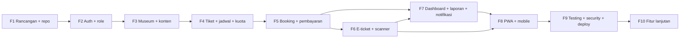

# Roadmap Implementasi

Dokumen turunan dari `SYSTEM_DESIGN.md` (§20). ID kebutuhan (`FR-*`), aturan (`BR-*`), dan tabel mengacu ke dokumen lain.

> **Aturan kerja:** implementasi **dimulai fase demi fase** hanya setelah instruksi eksplisit, misalnya: *"Rancangan disetujui. Mulai implementasi Fase 1."* Setiap fase selesai bila seluruh *acceptance criteria* terpenuhi dan tes hijau. Estimasi bersifat **[Asumsi]** (1–2 developer) dan hanya urutan prioritas.

## Ringkasan

| Fase | Nama | Estimasi | Bergantung pada |
|---|---|---|---|
| 1 | Finalisasi rancangan dan setup repositori | 1 minggu | – |
| 2 | Setup proyek, autentikasi, role, permission | 1–2 minggu | 1 |
| 3 | Modul museum dan pengelolaan konten | 2 minggu | 2 |
| 4 | Jenis tiket, jadwal, dan kuota | 2 minggu | 3 |
| 5 | Booking dan payment gateway | 2–3 minggu | 4 |
| 6 | E-ticket dan QR scanner | 2 minggu | 5 |
| 7 | Dashboard, laporan, dan notifikasi | 2 minggu | 5, 6 |
| 8 | PWA dan optimasi mobile | 1–2 minggu | 3–7 |
| 9 | Testing, security review, deployment | 2 minggu | 1–8 |
| 10 | Fitur lanjutan | Berkelanjutan | 9 |

---

## Fase 1 — Finalisasi rancangan dan setup repositori

| | |
|---|---|
| **Tujuan** | Rancangan disetujui dan fondasi proyek siap |
| **Fitur/aktivitas** | Review dan persetujuan 5 dokumen; keputusan nama sementara; mulai pendaftaran akun Midtrans (sandbox → produksi), provider email, domain; inisialisasi repositori, branching, CI dasar; tempatkan `AGENTS.md` dan `docs/` |
| **Ketergantungan** | – |
| **Deliverable** | Repositori dengan `docs/` dan `AGENTS.md`; daftar keputusan terbuka (Q1–Q8) dengan pemilik; akun sandbox Midtrans |
| **Acceptance criteria** | (1) Anda menyetujui rancangan secara eksplisit. (2) Pertanyaan terbuka yang memblokir Fase 2–3 sudah dijawab. (3) Repositori dapat di-clone dan CI minimal berjalan. |

## Fase 2 — Setup proyek, autentikasi, role, permission

| | |
|---|---|
| **Tujuan** | Aplikasi dasar berjalan, pengguna dapat masuk, otorisasi berbasis role dan kepemilikan berfungsi |
| **Fitur** | FR-AUTH-01…05, 07, 08; Laravel 13 + Inertia + Vue + Tailwind; PostgreSQL + Redis lokal; migrasi `users`, `social_accounts`, `organizer_profiles`, `museum_staff`, `activity_logs`, `app_settings`; Enum dan Policy dasar; Seeder (admin awal); layout publik/user/organizer/admin; Pint, Larastan, Pest, CI; konfigurasi mail dev |
| **Ketergantungan** | Fase 1 |
| **Deliverable** | Aplikasi dapat diinstal dari nol dengan README; halaman auth; middleware `EnsureRole`; pendaftaran organizer berstatus `pending`; Google login (jika waktu) |
| **Acceptance criteria** | (1) Registrasi, verifikasi email, login, logout, reset password berfungsi. (2) Akses area `/organizer` dan `/admin` ditolak untuk role yang salah (tes otorisasi). (3) Aksi sensitif tercatat di `activity_logs`. (4) CI hijau (Pint, Larastan, Pest). (5) Login Google berhasil dan tidak membuat akun ganda untuk email yang sama. |

## Fase 3 — Modul museum dan pengelolaan konten

| | |
|---|---|
| **Tujuan** | Organizer dapat membuat museum lengkap, Admin memverifikasi, publik dapat melihatnya |
| **Fitur** | FR-MUS-01…04; FR-ORG-02…05, 12; FR-ADM-03…05, 09; tabel `museum_categories`, `museums`, `museum_images`, `facilities`, `museum_facility`, `museum_operating_hours`, `museum_closed_dates`, `content_pages`; unggah dan re-encode gambar; pencarian dan filter; peta (tautan arah + embed opsional); YouTube embed; alur status museum (`draft → pending_review → published/rejected/suspended`) |
| **Ketergantungan** | Fase 2 |
| **Deliverable** | CRUD museum untuk organizer; panel verifikasi admin; daftar dan detail museum publik; seed kategori/fasilitas |
| **Acceptance criteria** | (1) Organizer hanya melihat/mengubah museum miliknya (uji otorisasi). (2) Museum non-`published` tidak tampil publik. (3) Pengajuan verifikasi menolak museum tanpa foto, jam operasional, atau koordinat. (4) Unggahan non-gambar atau terlalu besar ditolak. (5) Pencarian + filter kategori/kota benar. (6) Perubahan data kritis tercatat di `activity_logs`. |

## Fase 4 — Jenis tiket, jadwal, dan kuota

| | |
|---|---|
| **Tujuan** | Inventori yang dapat dijual: jenis tiket, slot, dan kuota yang konsisten |
| **Fitur** | FR-ORG-06, 07; FR-BKG-02…04 (sisi ketersediaan); tabel `ticket_types`, `slot_templates`, `visit_slots` (dengan `CHECK`); command `slots:generate` terjadwal; override kuota per tanggal; endpoint ketersediaan bulanan dan slot harian; `QuotaService` (reserve/release) beserta tes konkurensi awal |
| **Ketergantungan** | Fase 3 |
| **Deliverable** | UI kelola tiket dan jadwal; kalender ketersediaan; `QuotaService` teruji |
| **Acceptance criteria** | (1) `slots:generate` idempoten (tidak menggandakan slot). (2) Tanggal tutup dan hari libur tidak menghasilkan slot. (3) Kuota tidak dapat diturunkan di bawah terjual+ditahan (BR-20). (4) Uji konkurensi: N proses paralel memesan kuota terakhir → total reserved ≤ capacity. (5) Endpoint ketersediaan merefleksikan status `Tersedia/Hampir penuh/Penuh`. |

## Fase 5 — Booking dan payment gateway

| | |
|---|---|
| **Tujuan** | Pengunjung dapat memesan dan membayar; status pembayaran akurat dan idempoten |
| **Fitur** | FR-BKG-01, 05…09; FR-PAY-01…08; tabel `bookings`, `booking_items`, `payments`, `payment_events`; `BookingService`, `PaymentService`, `MidtransClient`, `WebhookProcessor`; webhook dengan verifikasi signature + API status + idempotensi; job `bookings:expire`; pemeriksaan aktif payment `pending`; halaman checkout, status pembayaran, riwayat booking; antrean anomali (admin) |
| **Ketergantungan** | Fase 4 (dan akun sandbox Midtrans dari Fase 1) |
| **Deliverable** | Alur booking → bayar (sandbox) → `confirmed`; seluruh transisi status sesuai `SYSTEM_DESIGN.md` §11.2 |
| **Acceptance criteria** | (1) Dua pengguna memesan kuota terakhir → satu berhasil, satu 409. (2) Webhook duplikat tidak membuat transaksi/tiket ganda. (3) Signature salah → 403 dan tidak ada perubahan status. (4) Pembayaran sukses saat browser ditutup tetap mengonfirmasi booking. (5) Booking kedaluwarsa melepas kuota. (6) `gross_amount` tidak cocok → `needs_review`. (7) Pembayaran terlambat setelah `expired` mengikuti BR-23. (8) Status pembayaran tidak pernah ditentukan oleh parameter redirect/frontend. |

## Fase 6 — E-ticket dan QR scanner

| | |
|---|---|
| **Tujuan** | Tiket terbit otomatis dan dapat dipindai aman di gerbang |
| **Fitur** | FR-TIX-01…06; FR-GATE-01…06; tabel `tickets`, `ticket_scans`; `TicketIssuer`, `TicketTokenSigner`, `ScanService`; halaman My Tickets dan detail e-ticket (QR client-side); penyimpanan offline (IndexedDB); tautan Google Calendar + .ics; Gate Scanner (kamera + input manual + 7 hasil berwarna); `museum_staff` untuk petugas; idempotensi `client_scan_uuid`; command `tickets:expire` |
| **Ketergantungan** | Fase 5 |
| **Deliverable** | Tiket terbit di transaksi konfirmasi; PWA scanner; riwayat scan |
| **Acceptance criteria** | (1) Satu tiket per orang, kode unik. (2) Tiket sama dipindai dua kali (juga bersamaan) → satu `valid`, sisanya `already_used`. (3) Petugas museum A memindai tiket museum B → `wrong_museum`. (4) Token yang dimodifikasi → `invalid`. (5) Retry dengan `client_scan_uuid` sama mengembalikan hasil awal. (6) Tiket yang pernah dibuka tampil offline dengan label "Tidak terverifikasi". (7) Scanner berfungsi di minimal satu perangkat Android dan satu iOS (uji nyata). |

## Fase 7 — Dashboard, laporan, dan notifikasi

| | |
|---|---|
| **Tujuan** | Pengelola dan admin dapat memantau operasional; pengunjung menerima informasi tepat waktu |
| **Fitur** | FR-ORG-01, 08…11; FR-ADM-01, 02, 06, 07, 10; FR-NTF-01…03; `email_logs`; template email (verifikasi, reset, konfirmasi, bukti bayar, e-ticket, pembatalan, pengingat H-1); notifikasi in-app; laporan penjualan/kunjungan + ekspor CSV; dashboard organizer dan admin; daftar pengunjung; kelola staf gate; log aktivitas |
| **Ketergantungan** | Fase 5, 6 |
| **Deliverable** | Dashboard dan laporan; email transaksional terkirim lewat queue; in-app notification |
| **Acceptance criteria** | (1) Angka dashboard cocok dengan data sumber (uji rekonsiliasi sampel). (2) Organizer tidak dapat melihat data museum lain di laporan. (3) Email gagal di-retry dan tercatat di `email_logs`. (4) Pengingat H-1 terkirim sekali per booking. (5) Ekspor CSV tidak memuat data di luar kepemilikan. |

## Fase 8 — PWA dan optimasi mobile

| | |
|---|---|
| **Tujuan** | Pengalaman seperti aplikasi, cepat di mobile, dapat dipasang |
| **Fitur** | FR-PWA-01…04; manifest, ikon (maskable), service worker (strategi cache §15), halaman offline, prompt instal (+ petunjuk iOS); optimasi gambar dan performa; audit aksesibilitas; SEO halaman publik (meta, sitemap, opsional Inertia SSR); tema visual final dan nama aplikasi final |
| **Ketergantungan** | Fase 3–7 |
| **Deliverable** | PWA installable; laporan Lighthouse; panduan instal |
| **Acceptance criteria** | (1) Lulus kriteria installability (Lighthouse/DevTools). (2) Halaman checkout/status/scan tidak pernah dilayani dari cache (NetworkOnly). (3) E-ticket offline sesuai §15.3. (4) Pembaruan service worker tidak memutus checkout. (5) LCP ≤ 2,5 s pada profil 4G uji. (6) Navigasi dan form dapat dipakai pada 360 px. |

## Fase 9 — Testing, security review, deployment

| | |
|---|---|
| **Tujuan** | Siap produksi: aman, teruji, dapat dipantau dan dipulihkan |
| **Fitur** | Suite lengkap (§19) termasuk konkurensi dan webhook; penetration/security review (checklist §16); `composer audit`/`npm audit`; header keamanan; rate limiting final; produksi: VPS, Nginx, PHP-FPM, Supervisor, cron, Redis, PostgreSQL, TLS; backup dan **uji restore**; monitoring + alarm; akun Midtrans produksi dan webhook produksi; UAT dengan museum pilot; dokumen operasional (SOP gate, runbook anomali pembayaran); kebijakan privasi dan syarat layanan |
| **Ketergantungan** | Fase 1–8 |
| **Deliverable** | Lingkungan produksi; laporan UAT; runbook; checklist go-live |
| **Acceptance criteria** | (1) 13 skenario kunci §19 lulus. (2) Tidak ada temuan keamanan kritis/tinggi yang terbuka. (3) Restore backup berhasil diuji. (4) Pembayaran produksi bernilai kecil berhasil end-to-end (booking → tiket → scan). (5) Alarm antrean/webhook terbukti aktif. (6) UAT disetujui oleh perwakilan museum pilot. |

## Fase 10 — Fitur lanjutan (berkelanjutan)

| | |
|---|---|
| **Tujuan** | Meningkatkan nilai produk setelah inti stabil |
| **Kandidat (urut prioritas usulan)** | Refund otomatis + kebijakan pembatalan; web push FCM; login Facebook/TikTok; nama pengunjung per tiket + QR dinamis; kode promo; reschedule; kuota per jenis tiket + harga terjadwal; unduh PDF tiket; review dan wishlist; chatbot AI (Gemini); mode scan offline terbatas; tiket rombongan; payout/komisi; jenis tempat lain (`venue_type`); aplikasi native |
| **Ketergantungan** | Fase 9 |
| **Deliverable** | Dirinci per fitur sebagai mini-fase dengan spesifikasi terpisah |
| **Acceptance criteria** | Ditetapkan per fitur sebelum dikerjakan; tidak boleh menurunkan keamanan/konsistensi inti |

---

## Cara memakai roadmap dengan Google Antigravity

1. Taruh `AGENTS.md` di root dan 5 dokumen di `docs/`.
2. Untuk tiap fase, berikan instruksi: *"Rancangan disetujui. Mulai implementasi Fase N."* Minta agen **menyusun rencana implementasi lebih dulu** (mode perencanaan) dan menunggu persetujuan sebelum menulis kode.
3. Satu fase = satu cabang Git + satu *pull request*; wajib lolos Pint, Larastan, dan Pest sebelum merge.
4. Jika agen menemukan ketidaksesuaian antara dokumen dan kode, **perbarui dokumen terlebih dahulu** (atau tanyakan), jangan menyimpang diam-diam.
5. Jangan biarkan agen mengubah aturan inti (BR-05…BR-16, §11.2) tanpa persetujuan eksplisit.
