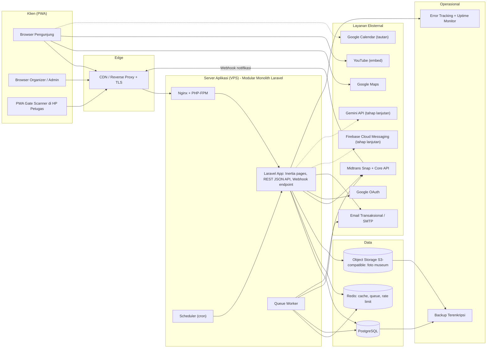
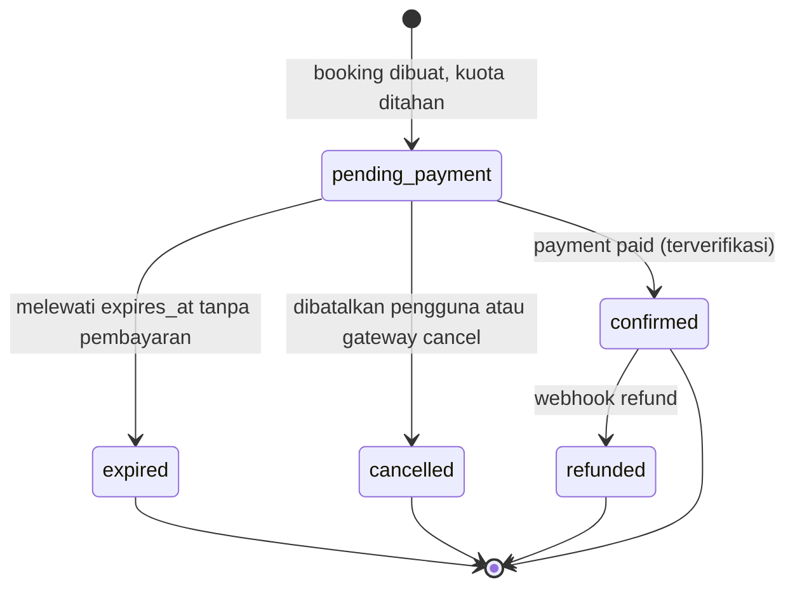
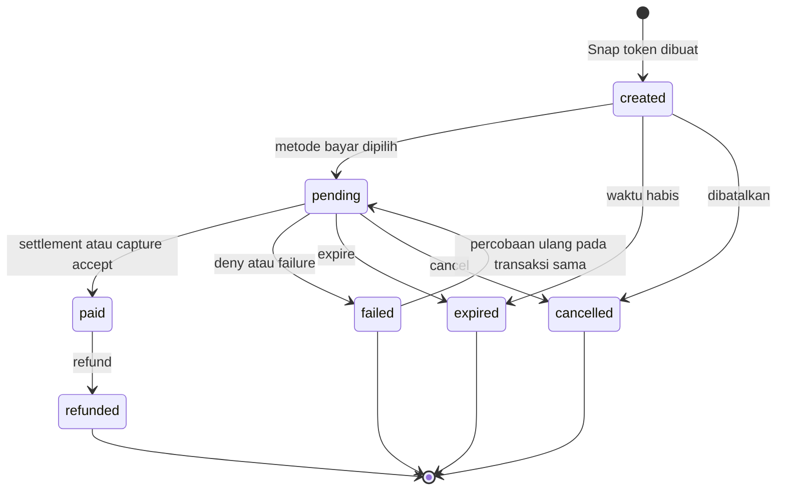
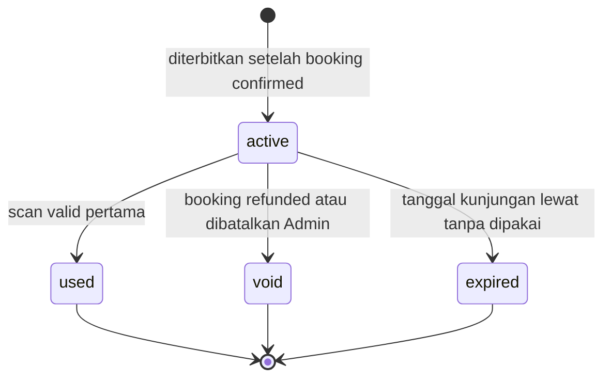

# SYSTEM DESIGN — Aplikasi Ticketing Museum Berbasis PWA

| | |
|---|---|
| **Versi dokumen** | 1.0 (Tahap 1: analisis dan perancangan) |
| **Tanggal** | 2 November 2026 |
| **Status** | Menunggu persetujuan eksplisit sebelum implementasi |
| **Dokumen terkait** | `ERD.md`, `UML.md`, `THIRD_PARTY_INTEGRATIONS.md`, `ROADMAP.md`, `AGENTS.md` (konteks agen untuk Google Antigravity) |
| **Target development** | Google Antigravity (lihat `AGENTS.md`) |

> **Cara membaca dokumen ini.** Setiap keputusan diberi ID (`D-xx`), kebutuhan diberi ID (`FR-xx`, `NFR-xx`), aturan bisnis diberi ID (`BR-xx`). ID ini dipakai konsisten di semua dokumen supaya agen development dapat menelusuri kebutuhan → tabel → diagram → fase.
> Penanda: **[Fakta]** = hal yang dapat diverifikasi; **[Rekomendasi]** = pilihan perancang beserta alasan; **[Asumsi]** = hal yang belum dikonfirmasi bisnis; **[Verifikasi]** = harus dicek ke dokumentasi resmi sebelum dipakai.

---

## 1. Ringkasan Proyek

Aplikasi ini adalah **platform pemesanan tiket museum online** berbasis **Progressive Web App (PWA)**. Pengunjung mencari museum, memilih jenis tiket, tanggal, dan slot waktu, membayar lewat Midtrans, lalu menerima e-ticket ber-QR yang dipindai petugas di gerbang. Pengelola museum (Organizer) mengelola konten, tiket, jadwal, kuota, dan laporan. Admin Platform memverifikasi pengelola/museum dan memantau seluruh transaksi.

**Prioritas teknis utama** (urutan sesuai file acuan): (1) konsistensi kuota tanpa overbooking, (2) keamanan pembayaran (webhook terverifikasi dan idempotent), (3) validitas tiket (satu tiket hanya lolos scan sekali).

### 1.1 Keputusan yang ditetapkan (hasil persetujuan default klarifikasi)

| ID | Keputusan | Catatan |
|---|---|---|
| D-01 | Platform **multi-museum, multi-organizer** | Satu database bersama, isolasi data lewat `museum_id`/`organizer_id` |
| D-02 | **Modular monolith** (satu aplikasi Laravel), bukan microservices | Sederhana, mudah di-deploy dan di-debug |
| D-03 | **Laravel 13** (PHP 8.3+) | **[Fakta]** per pencarian saat penyusunan: Laravel 13 dirilis 17 Maret 2026 dan memerlukan PHP 8.3+. **[Verifikasi]** versi patch terbaru saat setup proyek |
| D-04 | **PostgreSQL 16+** sebagai database utama | Skema dijaga portabel ke MySQL 8 (lihat `ERD.md` §1) |
| D-05 | **Inertia.js + Vue 3 + TypeScript + Tailwind CSS** | Satu codebase, UX mobile-first, mudah dijadikan PWA |
| D-06 | **Redis** untuk queue, cache, rate limiter (sesi tetap di database atau Redis) | Satu layanan untuk tiga kebutuhan |
| D-07 | Payment gateway **Midtrans Snap**; **refund manual** via dashboard Midtrans (tercatat otomatis lewat webhook) | Refund otomatis = tahap lanjutan |
| D-08 | Slot waktu **opsional per museum** (`booking_mode`: `daily` atau `timed_slot`) | Kuota selalu disimpan di entitas `visit_slots` |
| D-09 | Satu booking = **satu museum + satu slot/tanggal**, boleh berisi beberapa jenis tiket | |
| D-10 | **Checkout wajib login** (tanpa guest checkout) | **[Asumsi A11]** Memudahkan riwayat, e-ticket, dan pencegahan penyalahgunaan |
| D-11 | Data pengunjung di MVP: **hanya data pemesan**; satu booking dengan N tiket menghasilkan N baris `tickets` | Kolom `holder_name` disiapkan (nullable) untuk tahap lanjutan |
| D-12 | **Gate Staff = permission turunan Organizer** lewat tabel `museum_staff`, bukan role global | Role global hanya `admin`, `organizer`, `user` |
| D-13 | Validasi scan **online saja** di MVP | Mode offline = tahap lanjutan (lihat `THIRD_PARTY_INTEGRATIONS.md` §9.6) |
| D-14 | Notifikasi MVP: **email + in-app**. Web push (FCM) = tahap lanjutan. Pusher **tidak** dipakai | |
| D-15 | Login sosial MVP: **Google** (prioritas *should-have*). Facebook dan TikTok = tahap lanjutan | |
| D-16 | Google Maps MVP: koordinat + tautan arah + embed; Google Calendar MVP: **tautan "Tambah ke Kalender" + file .ics**, tanpa OAuth | |
| D-17 | AI Chatbot (Gemini) = **tahap lanjutan** | |
| D-18 | Primary key `bigint`; entitas yang terekspos ke publik memakai `public_id` **ULID** (char 26) | Mencegah enumerasi ID |
| D-19 | Uang disimpan sebagai **integer rupiah** (`bigint`, kolom berakhiran `_amount`), mata uang `IDR` | Tanpa floating point |
| D-20 | Batas waktu pembayaran default **15 menit** (`app_settings.payment_window_minutes`) | Dapat diubah Admin |
| D-21 | Role global disimpan sebagai kolom `users.role` + Laravel Policies (tanpa package permission) | Cukup untuk 3 role; dapat dimigrasi ke package permission bila role bertambah |

### 1.1a Keputusan tambahan (Fase 3)

| ID | Keputusan | Catatan |
|---|---|---|
| D-22 | Status museum: `draft`, `pending_review`, `published`, `rejected`, `suspended`, `archived` | Menyatukan BR-21 (`published/rejected`), §12.3 (`suspended`), dan ERD (`archived`). `approved` dihapus karena bermakna sama dengan `published` |
| D-23 | Fasilitas memakai **master `facilities` + pivot `museum_facility`** | Memenuhi FR-ADM-05 (Admin mengelola master) dan menjaga konsistensi penamaan fasilitas lintas museum. `museum_facilities` (denormalisasi) dibatalkan |
| D-24 | Video museum disimpan sebagai `museums.youtube_video_id` (char 11) | Sesuai THIRD_PARTY §6: backend mengekstrak ID dari URL, regex `^[A-Za-z0-9_-]{11}$`; tidak menyimpan HTML/iframe pengguna |
| D-25 | Nama kolom mengikuti BR/D-08: `max_tickets_per_booking`, `entry_early_minutes`, `entry_late_minutes`, `booking_mode = daily\|timed_slot` | ERD disesuaikan. Dua kolom grace menggantikan `entry_grace_minutes` agar jendela scan eksplisit (BR-15) |

### 1.2 Di luar cakupan MVP (tahap lanjutan / opsional)

Refund otomatis, reschedule booking, kode promo/voucher, tiket rombongan, nama pengunjung per tiket, kuota per jenis tiket, harga terjadwal (`ticket_prices`), review dan wishlist, web push FCM, login Facebook/TikTok, chatbot AI, mode scan offline, aplikasi native, payout/komisi ke museum.

---

## 2. Rekomendasi Nama Aplikasi

> **[Verifikasi]** Ketersediaan domain, handle media sosial, dan merek dagang (cek PDKI/DJKI) **belum diperiksa**. Nama di bawah hanya usulan.

| # | Nama | Makna / alasan | Catatan risiko |
|---|---|---|---|
| 1 | **Jejak** | Jejak sejarah dan jejak kunjungan; netral untuk galeri, situs, event | Kata umum, kemungkinan banyak dipakai |
| 2 | **Lawang** | "Pintu/gerbang" (Jawa/Sunda); cocok untuk tiket masuk | Berasosiasi kuat dengan *Lawang Sewu* (Semarang) |
| 3 | **Singgah** | Mampir/berkunjung; ramah, tidak membatasi jenis tempat | Bisa terkesan kurang "premium" |
| 4 | **Kala** | Waktu/masa; cocok untuk sejarah dan slot waktu | Sangat pendek, sulit dicari di mesin pencari |
| 5 | **Ruang Waktu** | Museum sebagai ruang menyimpan waktu | Dua kata, agak panjang untuk ikon |
| 6 | **Arsipa** | Arsip + akhiran modern | Terkesan arsip dokumen |
| 7 | **Pamer** | Dari "pameran" | Konotasi "pamer" dalam arti lain |
| 8 | **Wiyata** | Pendidikan/pengetahuan | Kurang dikenal generasi muda |
| 9 | **Nusa Tiket** | Jelas fungsinya, skala nasional | Kurang berkarakter, terlalu literal |
| 10 | **Galeri Kita** | Hangat dan inklusif | Membatasi ke galeri |
| 11 | **Cakra** | Roda/siklus/lingkaran waktu; modern | Berasosiasi dengan banyak merek |
| 12 | **Tamasya Budaya** | Eksplorasi budaya | Panjang |

**Tiga terbaik**
1. **Jejak** (rekomendasi utama): singkat, bermakna ganda (sejarah dan jejak kunjungan), mudah diucapkan, tidak membatasi ke museum sehingga aman untuk ekspansi ke situs sejarah, galeri, dan event.
2. **Singgah**: ramah dan mengundang, cocok untuk platform multi-tempat wisata edukasi.
3. **Lawang**: filosofi "gerbang" sangat pas dengan QR gate; **catatan**: periksa konflik asosiasi dengan *Lawang Sewu* sebelum dipakai.

**Implikasi teknis:** nama aplikasi **tidak boleh di-hardcode**. Pakai `APP_NAME` dan `config('app.name')` di seluruh kode, manifest PWA, dan template email, sehingga nama dapat diganti tanpa refactor.

---

## 3. Referensi dan Analisis Platform Sejenis

> Pola di bawah bersifat umum dan perlu **dipelajari langsung** (buat akun uji, coba alurnya). Jangan menyalin desain, tata letak, atau identitas visual; gunakan hanya sebagai pembelajaran pola UX. **[Verifikasi]** fitur spesifik tiap platform sebelum dijadikan acuan.

| Referensi | Jenis | Yang dipelajari |
|---|---|---|
| Klook, KKday, Traveloka Xperience, Tiket.com (atraksi) | Agregator tiket atraksi | Pemilihan tanggal + jenis tiket + jumlah dalam satu panel; kalender ketersediaan; voucher QR instan; ulasan |
| Situs resmi museum dengan *timed entry* (mis. Louvre, Rijksmuseum, Museum MACAN) | Reservasi museum langsung | Pemilihan slot waktu, kapasitas per slot, aturan kedatangan, halaman informasi kunjungan yang jelas |
| Loket, Eventbrite | Ticketing event | Dashboard penyelenggara, laporan penjualan, check-in via scan |
| Google Maps / Google Calendar | Layanan pendukung | Pola tautan arah dan "tambah ke kalender" |

**Aspek yang dianalisis**

| Aspek | Pola baik yang dipelajari | Penerapan di aplikasi ini |
|---|---|---|
| Alur cari dan pesan | Sedikit langkah, filter jelas, harga "mulai dari" terlihat di kartu | Daftar museum dengan filter kategori dan kota; checkout 3 langkah (pilih → data pemesan → bayar) |
| Detail museum | Galeri besar, info praktis (jam, lokasi, fasilitas) di atas lipatan, tombol "Pesan" lengket di mobile | Halaman detail dengan *sticky booking bar* |
| Tanggal dan jadwal | Kalender dengan penanda tersedia/penuh/tutup; slot ditampilkan sisa kuota | Kalender ketersediaan + daftar slot dengan status `Tersedia`, `Hampir penuh`, `Penuh` |
| E-ticket dan QR | QR besar, kontras tinggi, detail kunjungan ringkas, dapat dibuka offline | Halaman tiket dengan QR client-side, tersimpan untuk offline (lihat §15) |
| Dashboard pengelola | Ringkasan penjualan hari ini, kapasitas slot, tombol scan menonjol | Dashboard organizer dengan kartu ringkas + akses cepat ke Gate Scanner |
| Pengalaman mobile | Tombol besar, form pendek, pembayaran yang tidak keluar dari konteks | Mobile-first, Midtrans Snap (popup/redirect), PWA installable |

---

## 4. Identifikasi Masalah

> **[Asumsi]** Tidak semua museum memiliki proses yang sama. Poin bertanda ⚑ perlu dikonfirmasi per museum saat onboarding.

| # | Masalah | Dampak bagi pengunjung | Dampak bagi pengelola | Solusi aplikasi |
|---|---|---|---|---|
| P1 | Informasi museum dan harga tersebar/tidak terkini | Salah ekspektasi harga dan jam; batal berkunjung | Banyak pertanyaan berulang ke petugas | Halaman detail terpusat, dikelola Organizer, diverifikasi Admin |
| P2 | Jam operasional, jadwal, dan kuota tidak terpusat ⚑ | Datang saat tutup/penuh | Kepadatan tak terkendali, pengalaman buruk | Kalender operasional, tanggal tutup, slot dan kuota real-time |
| P3 | Antrean pembelian tiket di lokasi | Waktu terbuang | Gerbang macet, petugas kewalahan | Pembelian online + e-ticket, scan cepat |
| P4 | Pemesanan dan pencatatan manual ⚑ | Tidak ada bukti yang rapi | Rawan salah catat, rekap lambat | Booking, pembayaran, dan tiket tercatat otomatis dan dapat diaudit |
| P5 | Sulit memantau transaksi dan jumlah pengunjung | (tidak langsung) | Keputusan operasional tanpa data | Dashboard dan laporan penjualan/kunjungan, ekspor CSV |
| P6 | Tiket palsu atau dipakai berkali-kali | Tiket sah ditolak karena "sudah dipakai" oleh orang lain | Kebocoran pendapatan | Token QR bertanda tangan (HMAC), validasi ke backend, penandaan `used` atomik |
| P7 | Bukti pemesanan dan info kunjungan sulit diperoleh | Tiket hilang/tertukar | Beban layanan pelanggan | E-ticket di akun + email + simpan offline + tambah ke kalender |
| P8 | Pembayaran sudah berhasil tetapi tiket tak terbit (gangguan jaringan/browser tertutup) | Kehilangan uang, tidak percaya | Komplain, rekonsiliasi manual | Webhook server-to-server sebagai sumber kebenaran, idempotensi, deteksi anomali |
| P9 | Overbooking saat kuota terakhir diperebutkan | Datang tapi ditolak | Reputasi turun, kompensasi | Penguncian baris slot dalam transaksi database (lihat `ERD.md` §5) |

---

## 5. Tujuan, Manfaat, dan Indikator Keberhasilan

**Tujuan:** menyediakan platform tiket museum yang aman, andal, dan mudah dipakai di perangkat mobile maupun desktop, dengan fondasi yang dapat berkembang ke jenis tempat lain.

| Pihak | Manfaat |
|---|---|
| Pengunjung | Informasi jelas, pesan dari mana saja, tanpa antre, bukti tiket aman, pengingat kunjungan |
| Organizer | Hemat proses manual, kontrol kuota dan harga, data pengunjung dan penjualan real-time, scan cepat |
| Admin Platform | Kontrol kualitas konten, visibilitas transaksi, audit trail, laporan lintas museum |
| Operasional museum | Distribusi pengunjung merata (slot), gerbang lebih lancar, pencegahan kebocoran tiket |

**Indikator keberhasilan (target usulan, **[Asumsi]** disesuaikan setelah ada baseline)**

| Indikator | Cara ukur | Target awal |
|---|---|---|
| Kemudahan pemesanan | Waktu median dari buka detail museum sampai pembayaran dimulai | ≤ 3 menit |
| Konversi checkout | Booking `confirmed` / booking dibuat | ≥ 60% |
| Pengurangan proses manual | % tiket terjual lewat sistem di museum pilot | ≥ 80% |
| Akurasi data kunjungan | Selisih jumlah scan `valid` vs hitungan manual sampel harian | ≤ 2% |
| Integritas kuota | Jumlah kasus overbooking | 0 |
| Konsistensi pembayaran | Pembayaran `paid` tanpa tiket terbit (setelah 5 menit) | 0 |
| Kecepatan gerbang | Waktu median scan sampai hasil tampil | ≤ 2 detik |
| Kemudahan pemantauan | Admin/Organizer dapat melihat penjualan hari ini tanpa ekspor manual | 100% fitur dashboard tersedia |

---

## 6. Role dan Hak Akses

### 6.1 Role

| Role | Penyimpanan | Lingkup data |
|---|---|---|
| **Admin Platform** | `users.role = admin` | Seluruh platform |
| **Organizer** | `users.role = organizer` + `organizer_profiles`; memiliki `museums` | Hanya museum miliknya (`museums.organizer_id`) |
| **User / Pengunjung** | `users.role = user` | Hanya data miliknya sendiri |
| **Gate Staff** | Bukan role global. `users.role = user` + baris `museum_staff` (`staff_role = gate_staff`) | Hanya fitur scan untuk museum yang ditugaskan |

**Keputusan Gate Staff (D-12) [Rekomendasi]:** cukup sebagai **permission turunan Organizer** pada MVP. Alasan: kebutuhan petugas gate hanya satu (scan dan lihat riwayat), data akses selalu terikat museum tertentu, dan role global tambahan menambah kompleksitas otorisasi. Organizer membuat akun petugas (atau mengundang akun yang ada) lalu menugaskannya ke museum. Jika kelak butuh peran lain (mis. `manager`, `finance`), tabel `museum_staff.staff_role` sudah dapat diperluas.

### 6.2 Matriks hak akses

Legenda: ✅ penuh · 🔒 hanya milik sendiri / museum yang ditugaskan · ❌ tidak boleh · ◑ sebagian (lihat catatan)

| Fitur | Guest | User | Gate Staff | Organizer | Admin |
|---|:--:|:--:|:--:|:--:|:--:|
| Lihat daftar dan detail museum (published) | ✅ | ✅ | ✅ | ✅ | ✅ |
| Registrasi, login, lupa password | ✅ | – | – | – | – |
| Kelola profil akun sendiri | ❌ | 🔒 | 🔒 | 🔒 | 🔒 |
| Membuat booking dan membayar | ❌ | ✅ | ✅* | ✅* | ✅* |
| Lihat riwayat booking dan e-ticket sendiri | ❌ | 🔒 | 🔒 | 🔒 | 🔒 |
| Tambah ke Google Calendar | ❌ | 🔒 | 🔒 | 🔒 | 🔒 |
| Daftar sebagai organizer | ✅ | ✅ | ❌ | – | – |
| Kelola profil museum, galeri, fasilitas | ❌ | ❌ | ❌ | 🔒 | ✅ |
| Kelola jam operasional, tanggal tutup | ❌ | ❌ | ❌ | 🔒 | ✅ |
| Kelola jenis dan harga tiket | ❌ | ❌ | ❌ | 🔒 | ✅ |
| Kelola template slot dan kuota | ❌ | ❌ | ❌ | 🔒 | ✅ |
| Ajukan museum untuk verifikasi | ❌ | ❌ | ❌ | 🔒 | – |
| Verifikasi/moderasi museum dan organizer | ❌ | ❌ | ❌ | ❌ | ✅ |
| Lihat daftar booking dan status bayar | ❌ | ❌ | ❌ | 🔒 | ✅ |
| Lihat daftar pengunjung | ❌ | ❌ | ◑ | 🔒 | ✅ |
| Pindai tiket di gerbang | ❌ | ❌ | 🔒 | 🔒 | ❌** |
| Lihat riwayat scan | ❌ | ❌ | 🔒 (scan sendiri) | 🔒 (semua museum miliknya) | ✅ |
| Kelola staf gate | ❌ | ❌ | ❌ | 🔒 | ✅ |
| Laporan penjualan dan kunjungan | ❌ | ❌ | ❌ | 🔒 | ✅ |
| Kelola akun user dan organizer | ❌ | ❌ | ❌ | ❌ | ✅ |
| Kelola kategori dan fasilitas master | ❌ | ❌ | ❌ | ❌ | ✅ |
| Pantau semua transaksi dan anomali pembayaran | ❌ | ❌ | ❌ | 🔒 (museum sendiri, tanpa anomali gateway) | ✅ |
| Konfigurasi sistem, konten, FAQ | ❌ | ❌ | ❌ | ❌ | ✅ |
| Lihat activity log | ❌ | ❌ | ❌ | 🔒 (museum sendiri) | ✅ |

\* Selama login, semua role terautentikasi dapat membeli tiket sebagai pengunjung biasa (akun yang sama).
\** Admin tidak memindai tiket; jika dibutuhkan untuk dukungan operasional, tambahkan sebagai staf museum tertentu.
◑ Gate Staff hanya melihat informasi minimum saat scan (jenis tiket, tanggal/slot, nama pemesan), bukan daftar pengunjung lengkap.

**Aturan kepemilikan:** setiap query dan aksi Organizer/Gate Staff **wajib** dibatasi oleh kepemilikan museum (Policy + query scope). Uji eksplisit ada di `§19` (skenario 6 dan 7).

---

## 7. Kebutuhan Fungsional dan Nonfungsional

Prioritas: **M** = MVP wajib · **S** = MVP *should-have* (masuk MVP jika waktu cukup) · **L** = tahap lanjutan · **O** = opsional.

### 7.1 Kebutuhan fungsional

**Autentikasi dan akun (AUTH)**

| ID | Kebutuhan | Prio |
|---|---|:--:|
| FR-AUTH-01 | Registrasi email + password | M |
| FR-AUTH-02 | Verifikasi email | M |
| FR-AUTH-03 | Login dan logout | M |
| FR-AUTH-04 | Lupa dan reset password | M |
| FR-AUTH-05 | Login dengan Google | S |
| FR-AUTH-06 | Login Facebook / TikTok | L |
| FR-AUTH-07 | Kelola profil dan ganti password | M |
| FR-AUTH-08 | Pendaftaran organizer mandiri (menunggu verifikasi Admin) | M |

**Museum dan pencarian (MUS)**

| ID | Kebutuhan | Prio |
|---|---|:--:|
| FR-MUS-01 | Daftar museum berstatus `published` | M |
| FR-MUS-02 | Pencarian nama dan filter kategori/kota | M |
| FR-MUS-03 | Detail museum: galeri, deskripsi, fasilitas, jam operasional, harga mulai dari, video YouTube (opsional) | M |
| FR-MUS-04 | Peta lokasi dan tautan petunjuk arah | M |
| FR-MUS-05 | Wishlist | O |
| FR-MUS-06 | Review dan rating | O |

**Booking (BKG)**

| ID | Kebutuhan | Prio |
|---|---|:--:|
| FR-BKG-01 | Memilih jenis tiket dan jumlah (≤ `max_tickets_per_booking`) | M |
| FR-BKG-02 | Memilih tanggal kunjungan dengan kalender ketersediaan | M |
| FR-BKG-03 | Memilih slot waktu (museum `timed_slot`) | M |
| FR-BKG-04 | Pengecekan ketersediaan kuota real-time | M |
| FR-BKG-05 | Mengisi data pemesan (nama, email, telepon) | M |
| FR-BKG-06 | Membuat booking, menahan kuota, menetapkan batas waktu bayar | M |
| FR-BKG-07 | Membatalkan booking `pending_payment` oleh pemilik | M |
| FR-BKG-08 | Riwayat dan detail booking | M |
| FR-BKG-09 | Melanjutkan pembayaran booking yang masih pending | M |
| FR-BKG-10 | Reschedule booking | L |
| FR-BKG-11 | Refund otomatis | L |
| FR-BKG-12 | Kode promo/voucher | L |
| FR-BKG-13 | Tiket rombongan | L |
| FR-BKG-14 | Nama pengunjung per tiket | L |

**Pembayaran (PAY)**

| ID | Kebutuhan | Prio |
|---|---|:--:|
| FR-PAY-01 | Membuat transaksi Midtrans Snap dari backend | M |
| FR-PAY-02 | Menerima webhook, verifikasi signature | M |
| FR-PAY-03 | Idempotensi pemrosesan webhook | M |
| FR-PAY-04 | Verifikasi status ke API Midtrans sebelum mengubah booking | M |
| FR-PAY-05 | Halaman status pembayaran (polling status dari backend, bukan dari redirect) | M |
| FR-PAY-06 | Expire otomatis dan pelepasan kuota | M |
| FR-PAY-07 | Deteksi anomali (pembayaran masuk setelah booking kedaluwarsa, amount tidak cocok) → antrean Admin | M |
| FR-PAY-08 | Mencatat refund/chargeback yang terjadi di dashboard Midtrans melalui webhook | M |

**E-ticket (TIX)**

| ID | Kebutuhan | Prio |
|---|---|:--:|
| FR-TIX-01 | Menerbitkan satu tiket per orang setelah booking `confirmed` | M |
| FR-TIX-02 | E-ticket dengan QR (token bertanda tangan) dan kode manual | M |
| FR-TIX-03 | Halaman My Tickets dan detail tiket | M |
| FR-TIX-04 | Pengiriman e-ticket lewat email | M |
| FR-TIX-05 | Penyimpanan tiket untuk tampilan offline | M |
| FR-TIX-06 | Tambah ke Google Calendar (URL) dan unduh .ics | M |
| FR-TIX-07 | Unduh/cetak tiket PDF | L |

**Gate (GATE)**

| ID | Kebutuhan | Prio |
|---|---|:--:|
| FR-GATE-01 | Scanner QR via kamera perangkat petugas | M |
| FR-GATE-02 | Validasi online dan penandaan `used` secara atomik | M |
| FR-GATE-03 | Hasil scan visual: `valid`, `already_used`, `invalid`, `not_yet_valid`, `expired`, `wrong_museum`, `voided` | M |
| FR-GATE-04 | Input manual kode tiket sebagai cadangan | M |
| FR-GATE-05 | Riwayat scan | M |
| FR-GATE-06 | Idempotensi retry scan (`client_scan_uuid`) | M |
| FR-GATE-07 | Mode scan offline | L |

**Organizer (ORG)**

| ID | Kebutuhan | Prio |
|---|---|:--:|
| FR-ORG-01 | Dashboard statistik museum | M |
| FR-ORG-02 | Kelola profil museum, alamat, koordinat | M |
| FR-ORG-03 | Kelola galeri foto | M |
| FR-ORG-04 | Kelola fasilitas (dari master) | M |
| FR-ORG-05 | Kelola jam operasional dan tanggal tutup | M |
| FR-ORG-06 | Kelola jenis tiket dan harga | M |
| FR-ORG-07 | Kelola template slot dan kuota; override kuota per tanggal | M |
| FR-ORG-08 | Daftar booking dan status pembayaran | M |
| FR-ORG-09 | Daftar pengunjung per tanggal/slot | M |
| FR-ORG-10 | Kelola staf gate | M |
| FR-ORG-11 | Laporan penjualan dan kunjungan, ekspor CSV | M |
| FR-ORG-12 | Ajukan museum untuk verifikasi | M |
| FR-ORG-13 | Harga terjadwal | L |
| FR-ORG-14 | Kuota per jenis tiket | L |

**Admin (ADM)**

| ID | Kebutuhan | Prio |
|---|---|:--:|
| FR-ADM-01 | Dashboard statistik platform | M |
| FR-ADM-02 | Kelola akun user (suspend/aktifkan) | M |
| FR-ADM-03 | Verifikasi organizer | M |
| FR-ADM-04 | Verifikasi dan moderasi museum (approve/reject/suspend) | M |
| FR-ADM-05 | Kelola kategori dan fasilitas master | M |
| FR-ADM-06 | Pantau semua transaksi dan antrean anomali | M |
| FR-ADM-07 | Laporan lintas museum | M |
| FR-ADM-08 | Pengaturan sistem (`app_settings`) | M |
| FR-ADM-09 | Kelola konten umum dan FAQ | M |
| FR-ADM-10 | Melihat activity log | M |

**Notifikasi, PWA, dan lainnya**

| ID | Kebutuhan | Prio |
|---|---|:--:|
| FR-NTF-01 | Email transaksional (verifikasi, reset, konfirmasi booking, bukti bayar, e-ticket, pembatalan/perubahan) | M |
| FR-NTF-02 | Notifikasi in-app | M |
| FR-NTF-03 | Pengingat kunjungan H-1 | S |
| FR-NTF-04 | Web push (FCM) | L |
| FR-NTF-05 | Real-time (Pusher) | O |
| FR-PWA-01 | Web App Manifest dan installability | M |
| FR-PWA-02 | Service worker dan strategi cache | M |
| FR-PWA-03 | Halaman fallback offline | M |
| FR-PWA-04 | UI ajakan instal (Android/desktop) dan petunjuk instal (iOS) | M |
| FR-BOT-01 | Chatbot AI | L |

### 7.2 Kebutuhan nonfungsional

| ID | Kategori | Kebutuhan | Target |
|---|---|---|---|
| NFR-01 | Performa | Waktu respons server halaman daftar/detail museum | p95 ≤ 500 ms (tanpa cache dingin) |
| NFR-02 | Performa | Core Web Vitals di jaringan 4G | LCP ≤ 2,5 s; Lighthouse Performance ≥ 85 |
| NFR-03 | Performa | Validasi scan end-to-end | p95 ≤ 1 s di sisi server |
| NFR-04 | Konkurensi | N pengguna memesan kuota terakhir bersamaan | Tepat satu berhasil; tidak ada overbooking |
| NFR-05 | Ketersediaan | Uptime layanan | ≥ 99,5% per bulan (**[Asumsi]**) |
| NFR-06 | Integritas | Idempotensi webhook, atomisitas scan, constraint database | Dijamin di level database dan aplikasi |
| NFR-07 | Keamanan | Sesuai §16 (OWASP ASVS L1 sebagai acuan) | Tidak ada temuan kritis saat review |
| NFR-08 | Privasi | Minimasi data pribadi, kebijakan privasi, kepatuhan UU PDP | **[Verifikasi]** dengan konsultan hukum |
| NFR-09 | Skalabilitas | Dapat naik dengan menambah worker/replica tanpa ubah arsitektur | Stateless web, sesi dan cache di Redis |
| NFR-10 | Usability | Mobile-first, tombol sentuh ≥ 44 px, aksesibilitas WCAG 2.1 AA sebagai target | |
| NFR-11 | Kompatibilitas | Chrome/Edge/Firefox/Safari versi terbaru; Android 9+; iOS 16.4+ (untuk push dan PWA terpasang) | **[Verifikasi]** |
| NFR-12 | Maintainability | Coding standard (Laravel Pint), analisis statis (Larastan), cakupan tes modul inti ≥ 70% | |
| NFR-13 | Observability | Log terstruktur, error tracking, metrik antrean dan webhook | Lihat §8.5 |
| NFR-14 | Backup | RPO ≤ 24 jam (disarankan ≤ 1 jam untuk DB), RTO ≤ 4 jam | **[Asumsi]** |
| NFR-15 | Zona waktu | Penyimpanan timestamp UTC; tanggal/jam kunjungan dalam zona waktu museum (`museums.timezone`) | WIB/WITA/WIT |
| NFR-16 | i18n | UI Bahasa Indonesia; struktur siap multi-bahasa | |
| NFR-17 | Auditabilitas | Data transaksi dan tiket tidak dihapus; ada snapshot nama/harga | Lihat `ERD.md` |

---

## 8. Arsitektur Sistem

### 8.1 Pendekatan: modular monolith **[Rekomendasi]**

Satu aplikasi Laravel yang dipisahkan secara logis per modul (Museum, Schedule, Booking, Payment, Ticket, Gate, Reporting, Notification). **Alasan:** tim kecil, transaksi database lintas modul (booking + kuota + tiket) harus atomik, deploy dan debug lebih sederhana. **Kelemahan:** semua modul ikut ter-deploy bersamaan dan batas modul hanya dijaga disiplin kode. **Mitigasi:** modul berkomunikasi lewat Service class dan Event, tidak saling menyentuh tabel milik modul lain secara langsung.

### 8.2 Diagram arsitektur



### 8.3 Alur komunikasi dan tanggung jawab komponen

| Komponen | Tanggung jawab | Berkomunikasi dengan |
|---|---|---|
| PWA (Vue + Inertia) | UI, navigasi, service worker, render QR di sisi klien | Laravel (HTTP/JSON), Midtrans Snap.js, Google Maps embed |
| Laravel (web) | Autentikasi, otorisasi, logika bisnis, endpoint API dan webhook | PostgreSQL, Redis, S3, Midtrans, Google OAuth |
| Queue worker | Email, pemrosesan webhook, pembuatan tiket, notifikasi | Redis, PostgreSQL, Mail, Midtrans |
| Scheduler | Expire booking, generate slot, reminder H-1, rekonsiliasi kuota, pembersihan | Aplikasi (artisan) |
| PostgreSQL | Sumber kebenaran data, constraint, transaksi | Aplikasi |
| Redis | Antrean, cache, rate limiting, lock ringan | Aplikasi |
| Object storage | Foto museum dan aset unggahan | Aplikasi (upload), publik via CDN (baca) |

### 8.4 Penanganan lintas fungsi (ringkas)

| Topik | Rancangan |
|---|---|
| Autentikasi | Sesi berbasis cookie (Laravel session) untuk web dan PWA same-origin; Sanctum mode SPA/stateful untuk endpoint `/api/v1` yang diakses PWA; token personal hanya jika kelak ada klien native |
| Otorisasi | `users.role` + Laravel Policy per model; Organizer/Gate Staff dibatasi kepemilikan museum (`museums.organizer_id`, `museum_staff`) |
| Pembayaran | Backend membuat transaksi Snap; **status pembayaran hanya berasal dari webhook + verifikasi API Midtrans**, tidak dari redirect/frontend (detail: `THIRD_PARTY_INTEGRATIONS.md` §1) |
| Penerbitan tiket | Dalam transaksi database yang sama dengan konfirmasi booking: N baris `tickets` dengan `public_id` ULID dan `ticket_code`; token QR diturunkan dari `public_id` + HMAC (§11.3) |
| Scan gate | PWA scanner → `POST /api/v1/gate/scans` → validasi + update atomik → hasil JSON (detail: `UML.md` sequence C) |
| Email dan notifikasi | Dikirim lewat queue (`afterCommit`), dengan retry dan pencatatan di `email_logs`; notifikasi in-app di tabel `notifications` bawaan Laravel |
| Banyak museum | Single database + scoping `museum_id`; indeks diawali `museum_id`; path storage per museum; `museums.venue_type` disiapkan untuk jenis tempat lain |

### 8.5 Logging, monitoring, dan backup

| Aspek | Rancangan MVP |
|---|---|
| Log aplikasi | Log harian berformat JSON + `request_id`; jangan mencatat password, token, atau payload kartu |
| Audit log | Tabel `activity_logs` (append-only) untuk aksi penting: verifikasi museum, perubahan harga/kuota, refund/anomali, akses laporan, suspend akun |
| Error tracking | Layanan error tracking (mis. Sentry) **[Verifikasi]** harga/paket |
| Monitoring | Uptime monitor eksternal; metrik antrean (panjang, job gagal); alarm untuk lonjakan webhook gagal dan antrean macet |
| Backup | `pg_dump` terjadwal harian + arsip WAL bila diperlukan (RPO ≤ 1 jam untuk DB); salinan terenkripsi di lokasi berbeda; **uji pemulihan berkala** (minimal per kuartal) |
| Retensi | Data transaksi dan tiket disimpan untuk keperluan audit/perpajakan (lama **[Verifikasi]** ke konsultan pajak/hukum); log operasional 30–90 hari; `payment_events` mentah dapat diarsipkan setelah ≥ 12 bulan |

---

## 9. Rekomendasi Tech Stack

### 9.1 Perbandingan singkat

**Backend**

| Opsi | Kelebihan | Kekurangan | Keputusan |
|---|---|---|---|
| **Laravel 13** | Ekosistem matang untuk auth, queue, scheduler, mail, validasi, policy; produktivitas tinggi; dokumentasi luas | Bergantung PHP; perlu disiplin agar tidak "fat controller" | ✅ Dipilih |
| Node (NestJS/Express) | Satu bahasa dengan frontend | Harus merakit banyak komponen sendiri (auth, queue, mail) | Tidak |
| Django | Admin dan ORM kuat | Tim perlu Python; tidak ada ekosistem Inertia | Tidak |

**Frontend**

| Opsi | Kelebihan | Kekurangan | Keputusan |
|---|---|---|---|
| Blade (server-rendered) | Sederhana, SEO baik | Interaktivitas kompleks (kalender, scanner, dashboard) lebih sulit; PWA terasa kurang "app-like" | Tidak untuk area interaktif |
| **Inertia + Vue 3** | Tanpa API terpisah untuk halaman; auth/session Laravel langsung dipakai; komponen reaktif; mudah PWA | SEO halaman publik perlu SSR atau pre-render bila SEO krusial | ✅ Dipilih |
| React/Vue SPA terpisah | Pemisahan tegas, siap klien lain | Dua deployment, CORS/auth lebih rumit, biaya lebih tinggi | Ditunda; REST API tetap disiapkan |

**SEO halaman publik [Rekomendasi]:** halaman publik (daftar dan detail museum) memerlukan indeks mesin pencari. Aktifkan **Inertia SSR** pada tahap Fase 8 (atau sediakan meta tag dan sitemap server-rendered). **[Verifikasi]** dukungan dan cara setup SSR di versi Inertia/starter kit yang dipakai.

**Database**

| Opsi | Kelebihan | Kekurangan | Keputusan |
|---|---|---|---|
| **PostgreSQL 16+** | `SELECT ... FOR UPDATE` andal, constraint `CHECK`, tipe data kaya, pencarian teks (opsional `pg_trgm`) | Hosting shared jarang menyediakan | ✅ Dipilih |
| MySQL 8 | Tersedia luas di hosting | Konfigurasi isolasi dan sensitivitas collation perlu perhatian | Alternatif (skema dijaga portabel) |

### 9.2 Tabel ringkasan stack final

| Teknologi | Fungsi | Alasan | Status |
|---|---|---|---|
| PHP 8.3+ | Runtime | Syarat Laravel 13 | MVP |
| Laravel 13 | Framework backend | §9.1 | MVP |
| Inertia.js + Vue 3 + TypeScript | Frontend | §9.1 | MVP |
| Tailwind CSS | Styling responsif | Konsisten, cepat, mobile-first | MVP |
| `vite-plugin-pwa` (Workbox) | Manifest + service worker | Integrasi Vite, strategi cache terkonfigurasi **[Verifikasi]** kompatibilitas versi | MVP |
| PostgreSQL 16+ | Database | §9.1 | MVP |
| Redis | Queue, cache, rate limit | Satu layanan tiga fungsi | MVP |
| Laravel Queue + Supervisor | Worker email/webhook | Bawaan, andal | MVP |
| Laravel Scheduler (cron) | Tugas terjadwal | Bawaan | MVP |
| Laravel Socialite | Login Google | Resmi dari Laravel | MVP (S) |
| `midtrans/midtrans-php` | Integrasi Midtrans | SDK resmi **[Verifikasi]** kompatibilitas PHP 8.3 | MVP |
| Library QR server-side (mis. `endroid/qr-code`) | Membuat QR untuk email/PDF | Stabil | MVP |
| Library QR client-side (mis. `qrcode`) | Render QR di browser agar tersedia offline | Tidak butuh jaringan | MVP |
| Library scan QR (mis. `vue-qrcode-reader` atau `qr-scanner`) | Scanner kamera | **[Verifikasi]** dukungan iOS Safari | MVP |
| S3-compatible storage (S3 / R2 / MinIO) via Flysystem | Foto museum | Skalabel, CDN-friendly | MVP (lokal untuk dev) |
| Intervention Image (atau setara) | Resize dan re-encode unggahan | Keamanan + performa | MVP |
| Laravel Pint, Larastan, Pest | Style, analisis statis, testing | Kualitas | MVP |
| Sentry (atau setara) | Error tracking | Deteksi cepat | MVP |
| FCM Web Push | Push notification | Standar web push | Lanjutan |
| Laravel Horizon | Dashboard antrean | Hanya jika Redis + volume tinggi | Lanjutan |
| Gemini API | Chatbot | Lihat `THIRD_PARTY_INTEGRATIONS.md` §8 (H) | Lanjutan |

### 9.3 Katalog endpoint utama (acuan implementasi)

| Area | Method + Path | Auth | Keterangan |
|---|---|---|---|
| Publik | `GET /museums`, `GET /museums/{slug}` | – | Halaman Inertia |
| Publik | `GET /api/v1/museums/{slug}/availability?month=YYYY-MM` | – | Kalender ketersediaan |
| Publik | `GET /api/v1/museums/{slug}/slots?date=YYYY-MM-DD` | – | Slot + sisa kuota |
| Booking | `POST /api/v1/bookings` | user | Buat booking + tahan kuota |
| Booking | `POST /api/v1/bookings/{id}/cancel` | user (pemilik) | Batalkan `pending_payment` |
| Payment | `POST /api/v1/bookings/{id}/payments` | user (pemilik) | Buat percobaan bayar, kembalikan Snap token |
| Payment | `GET /api/v1/bookings/{id}/status` | user (pemilik) | Polling status dari DB |
| Webhook | `POST /webhooks/midtrans` | signature | Tanpa CSRF, dibatasi rate |
| Tiket | `GET /api/v1/me/tickets`, `GET /api/v1/me/tickets/{id}` | user | Payload QR untuk simpan offline |
| Gate | `GET /api/v1/gate/museums` | staf/organizer | Museum yang boleh dipindai |
| Gate | `POST /api/v1/gate/scans` | staf/organizer | Scan QR (`payload`) atau kode manual (`ticket_code`) |
| Gate | `GET /api/v1/gate/scans?museum_id=` | staf/organizer | Riwayat scan |
| Organizer/Admin | CRUD via halaman Inertia (`/organizer/*`, `/admin/*`) | role + policy | Lihat §17 |

Semua endpoint `/api/v1` memakai versi di path, validasi lewat Form Request, dan format error JSON seragam `{ "message": "...", "errors": { ... }, "code": "..." }`.

---

## 10. Perancangan Database dan ERD

Rancangan lengkap (ERD Mermaid, spesifikasi kolom, indeks, kardinalitas, soft delete, contoh data, strategi anti-overbooking, siklus kuota) ada di **`ERD.md`**. Ringkasannya:

| Kelompok | Tabel |
|---|---|
| Akun dan akses | `users`, `social_accounts`, `organizer_profiles`, `museum_staff` |
| Data museum | `museum_categories`, `museums`, `museum_images`, `facilities`, `museum_facility`, `museum_operating_hours`, `museum_closed_dates` |
| Tiket dan jadwal | `ticket_types`, `slot_templates`, `visit_slots` |
| Pemesanan dan pembayaran | `bookings`, `booking_items`, `payments`, `payment_events` |
| E-ticket dan gate | `tickets`, `ticket_scans` |
| Pendukung | `notifications` (bawaan Laravel), `email_logs`, `activity_logs`, `app_settings`, `content_pages` |
| Tabel infrastruktur Laravel | `password_reset_tokens`, `sessions`, `cache`, `jobs`, `failed_jobs` |
| Ditunda (tahap lanjutan) | `refunds`, `ticket_prices`, `slot_ticket_quotas`, `push_subscriptions`, `reviews`, `wishlists`, `promo_codes` |

Keputusan kunci: **kuota disimpan di `visit_slots`** (`capacity`, `reserved_count`, `sold_count`) dan diubah **hanya di dalam transaksi dengan `SELECT ... FOR UPDATE`** pada baris slot, dilindungi `CHECK (reserved_count + sold_count <= capacity)` sebagai jaring pengaman terakhir.

---

## 11. Business Rules dan Status Transaksi

### 11.1 Aturan bisnis

| ID | Aturan |
|---|---|
| BR-01 | Hanya museum berstatus `published` yang tampil dan dapat dipesan. |
| BR-02 | Organizer hanya mengakses museum miliknya (`museums.organizer_id`); Gate Staff hanya museum dalam `museum_staff` aktif. |
| BR-03 | Satu booking berisi tepat satu slot (satu museum, satu tanggal) dan ≥ 1 item tiket; total tiket ≤ `museums.max_tickets_per_booking` (default 10). |
| BR-04 | Pemesanan hanya untuk tanggal dalam rentang `hari ini` s.d. `booking_window_days` (default 60), bukan tanggal tutup, dan sebelum batas penjualan (`sales_cutoff_minutes`, default 30 menit sebelum slot dimulai / sebelum museum tutup untuk mode `daily`). |
| BR-05 | Saat booking dibuat, kuota **ditahan** (`reserved_count += qty`) dalam satu transaksi dengan penguncian baris slot. |
| BR-06 | Booking `pending_payment` punya `expires_at = created_at + payment_window_minutes` (default 15). Setelah lewat dan tidak ada pembayaran sukses, booking menjadi `expired` dan kuota dilepas (`reserved_count -= qty`). |
| BR-07 | Pembayaran sukses (`paid`) mengubah booking menjadi `confirmed`, memindahkan kuota dari `reserved_count` ke `sold_count`, dan menerbitkan tiket, **semua dalam satu transaksi**. |
| BR-08 | Pembayaran gagal/dibatalkan/kedaluwarsa melepas kuota (bila booking menjadi `cancelled`/`expired`). Kegagalan satu percobaan bayar (`failed`) **tidak** langsung membatalkan booking; pengguna boleh mencoba lagi selama booking belum kedaluwarsa. |
| BR-09 | Batas waktu transaksi di Midtrans (`payments.expires_at`) harus **lebih awal ±2 menit** dari `bookings.expires_at`. Percobaan bayar baru hanya diizinkan bila sisa waktu booking ≥ 3 menit. |
| BR-10 | Status pembayaran hanya boleh diubah oleh backend berdasarkan webhook yang tervalidasi **dan** hasil verifikasi API Midtrans, tidak pernah dari redirect/frontend. |
| BR-11 | `gross_amount` dari Midtrans harus sama dengan `payments.amount`; jika berbeda, transaksi ditandai anomali dan **tidak** dikonfirmasi otomatis. |
| BR-12 | Pemrosesan webhook idempoten: peristiwa yang sama (kunci idempoten sama) hanya diproses sekali; transisi status bersifat monoton (lihat §11.2). |
| BR-13 | Setiap tiket punya `public_id` dan `ticket_code` unik; satu baris `tickets` mewakili satu orang. |
| BR-14 | Satu tiket hanya boleh berhasil dipindai sekali: transisi `active → used` dilakukan dengan `UPDATE ... WHERE status = 'active'` dan hanya dianggap berhasil jika tepat satu baris terpengaruh. |
| BR-15 | Tiket hanya valid di museum, tanggal, dan jendela waktu slotnya: jendela = `[start_time − entry_early_minutes, end_time + entry_late_minutes]` untuk `timed_slot`; seluruh hari kunjungan (jam operasional) untuk `daily`. Default `entry_early_minutes = 15`, `entry_late_minutes = 30` (**[Asumsi]**, dapat diatur Organizer). |
| BR-16 | Urutan pemeriksaan scan: token valid → museum sesuai → tiket tidak `void` → belum `used` → jendela tanggal/waktu → tandai `used` atomik (§11.3). |
| BR-17 | QR tidak memuat data pribadi atau pembayaran; hanya token bertanda tangan. |
| BR-18 | Data transaksi (`bookings`, `booking_items`, `payments`, `payment_events`, `tickets`, `ticket_scans`, `activity_logs`) tidak pernah dihapus keras; tidak ada `DELETE` dari aplikasi. |
| BR-19 | Perubahan harga, nama jenis tiket, atau nama museum tidak mengubah booking lama (snapshot di `booking_items` dan `bookings.snapshot`). |
| BR-20 | Kuota (`capacity`) tidak boleh diturunkan di bawah `reserved_count + sold_count`; tanggal tutup tidak boleh dibuat pada tanggal yang sudah memiliki booking `confirmed` tanpa alur pembatalan/pemberitahuan (tahap lanjutan: MVP memblokir dan menampilkan peringatan). |
| BR-21 | Museum baru: `draft → pending_review → published/rejected`; perubahan data kritis pada museum `published` (nama, alamat, koordinat) dicatat di `activity_logs`. |
| BR-22 | Organizer baru harus berstatus `approved` sebelum dapat mengajukan museum. |
| BR-23 | Pembayaran yang masuk setelah booking `expired`: sistem mencoba memesan ulang kuota; bila gagal, booking tetap `expired`, payment `paid`, dan masuk **antrean anomali** untuk refund manual oleh Admin. |
| BR-24 | Akun `suspended` tidak dapat login; booking yang sudah `confirmed` tetap valid kecuali Admin memutuskan lain (dicatat di log). |

### 11.2 Status dan transisi yang diizinkan

**Booking** (`bookings.status`): `pending_payment`, `confirmed`, `expired`, `cancelled`, `refunded`



**Payment** (`payments.status`): `created`, `pending`, `paid`, `failed`, `expired`, `cancelled`, `refunded`



**Ticket** (`tickets.status`): `active`, `used`, `void`, `expired`



**Kondisi yang TIDAK boleh terjadi**

| Kondisi terlarang | Pengaman |
|---|---|
| `used → active` atau tiket `used` dipindai berhasil lagi | `UPDATE ... WHERE status='active'`; tidak ada jalur kode yang mengembalikan status |
| Booking `confirmed` tanpa payment `paid` | Konfirmasi hanya di service pembayaran dalam satu transaksi |
| Tiket terbit untuk booking bukan `confirmed` | Pembuatan tiket hanya di service yang sama |
| `paid → pending/created/failed` (mundur) | Transisi monoton; webhook terlambat dengan status "lebih rendah" diabaikan dan dicatat |
| `reserved_count + sold_count > capacity` | Penguncian baris + `CHECK` database |
| Booking `expired/cancelled` bertransisi menjadi `confirmed` secara diam-diam | Jalur anomali BR-23 yang eksplisit |
| Perubahan status payment dari input frontend | Endpoint status bersifat baca-saja; mutasi hanya di job webhook |

### 11.3 Token QR dan validitas tiket

- **Payload QR (versi 1):** `MT1.<kid>.<ticket_public_id>.<sig>`
  - `kid` = ID kunci penandatangan (mendukung rotasi kunci).
  - `ticket_public_id` = ULID tiket (bukan ID berurutan).
  - `sig` = `base64url( HMAC-SHA256( key[kid], "MT1." + ticket_public_id ) )` dipotong ke 22 karakter pertama.
- **Mengapa HMAC:** token tidak dapat ditebak atau dipalsukan tanpa kunci rahasia (`TICKET_SIGNING_KEYS` di environment, tidak di database), dan basis data yang bocor tidak cukup untuk membuat tiket palsu. Verifikasi tanda tangan dapat menolak token palsu **sebelum** query ke database.
- **Kode manual:** `ticket_code` (10 karakter Crockford base32, unik) hanya untuk input manual petugas, dibatasi rate dan hanya untuk staf yang berwenang.
- **Screenshot/penyalinan QR:** QR dapat difoto atau disalin; hanya **scan pertama** yang berhasil (BR-14). Mitigasi tambahan: nama pemesan dan jenis tiket tampil di layar petugas untuk dicocokkan; tahap lanjutan: QR dinamis berputar (TOTP) dan nama per tiket.
- **Validasi online (MVP):** status penggunaan selalu dibaca/ditulis di server sehingga konsisten. Mode offline menimbulkan risiko konflik sinkronisasi (dua perangkat memindai tiket yang sama sebelum sinkron) dan karena itu ditunda.

---

## 12. Alur Bisnis

### 12.1 Alur pengunjung

| Langkah | Deskripsi | Berhasil | Gagal / kondisi khusus |
|---|---|---|---|
| 1–3 | Buka aplikasi, cari/pilih museum, buka detail | Informasi tampil | Museum tidak `published` → 404 |
| 4–7 | Pilih jenis tiket, tanggal, slot (jika ada), jumlah | UI menampilkan ketersediaan | Tanggal tutup/penuh ditandai tidak dapat dipilih; slot penuh disabled |
| 8 | Sistem memeriksa kuota | Tersedia | Kuota berubah saat submit → pesan "kuota tidak cukup, pilih jumlah/slot lain" |
| 9 | Isi data pemesan (butuh login) | Valid | Belum login → diarahkan login lalu kembali ke checkout |
| 10 | Booking dibuat, kuota ditahan, hitung mundur dimulai | `pending_payment` | Kuota habis di detik terakhir → ditolak (409) |
| 11 | Bayar via Midtrans Snap | Menunggu notifikasi | Gagal membuat transaksi gateway → booking tetap pending, tombol "Coba bayar lagi" |
| 12–13 | Webhook diterima, diverifikasi, booking `confirmed` | Lanjut | Webhook terlambat/ganda → idempoten; browser tertutup → tiket tetap terbit dari webhook |
| 14–15 | Tiket terbit, email dan notifikasi dikirim | Tiket di "My Tickets" | Email gagal → di-retry; tiket tetap ada di akun |
| 16–19 | Datang, QR dipindai, tiket `used`, masuk | Masuk | `already_used`, `not_yet_valid`, `expired`, `wrong_museum`, `invalid`, `voided` → petugas diarahkan sesuai SOP |
| Pembayaran kedaluwarsa | Waktu habis | Kuota dilepas, booking `expired` | Pembayaran masuk terlambat → BR-23 (anomali) |

### 12.2 Alur organizer

| Tahap | Deskripsi | Berhasil | Gagal / kondisi khusus |
|---|---|---|---|
| 1. Pendaftaran | Registrasi akun, lengkapi profil organisasi dan dokumen | `organizer_profiles.verification_status = pending` | Data tidak lengkap → validasi |
| 2. Verifikasi organizer | Admin meninjau | `approved` | `rejected` + alasan; organizer boleh memperbaiki dan mengajukan ulang |
| 3. Membuat museum | Isi profil, galeri, fasilitas, jam operasional, koordinat (status `draft`) | Tersimpan | Foto invalid/terlalu besar ditolak |
| 4. Atur tiket dan jadwal | Jenis tiket + harga, template slot + kuota, tanggal tutup | Slot ter-generate | Kuota di bawah terjual ditolak (BR-20) |
| 5. Ajukan verifikasi | `draft → pending_review` | Menunggu Admin | Wajib: ≥ 1 foto, ≥ 1 jenis tiket aktif, jam operasional, koordinat |
| 6. Publikasi | Admin `approve` → `published` | Tampil publik | `rejected` + catatan |
| 7. Pantau booking | Dashboard, daftar booking, pengunjung | Data real-time | – |
| 8. Scan gate | Organizer/staf memindai tiket | Hasil valid | Lihat alur pengunjung langkah 16–19 |
| 9. Laporan | Penjualan dan kunjungan, ekspor CSV | Laporan tersedia | Rentang terlalu besar → batas/antrean ekspor |

### 12.3 Alur admin

| Tahap | Deskripsi | Berhasil | Gagal / kondisi khusus |
|---|---|---|---|
| Verifikasi organizer | Tinjau profil/dokumen | `approved` | `rejected` / `suspended` + alasan, tercatat di `activity_logs` |
| Verifikasi museum | Tinjau konten, harga, lokasi | `published` | `rejected`; museum `published` yang melanggar → `suspended` (booking baru diblok, booking `confirmed` ditangani manual) |
| Moderasi | Edit/menyembunyikan konten bermasalah | Konten diperbaiki | – |
| Pantau transaksi | Daftar semua booking/payment, filter status | – | Antrean **anomali** (BR-11, BR-23) → tindak lanjut refund manual dan catat |
| Kelola pengguna | Suspend/aktifkan | Status berubah | Suspend organizer menyembunyikan museumnya |
| Pelaporan | Statistik lintas museum | – | – |

---

## 13. UML

Seluruh diagram (use case, activity, sequence, state) ada di **`UML.md`**. Daftar:

| Jenis | Diagram |
|---|---|
| Use case | Use case per aktor (Pengunjung, Gate Staff, Organizer, Admin, Midtrans sebagai aktor sistem) |
| Activity | A1 Pemesanan dan pembayaran · A2 Scan QR di gerbang · A3 Pengelolaan dan publikasi museum oleh Organizer |
| Sequence | S1 Booking sampai e-ticket · S2 Webhook Midtrans · S3 Scan dan validasi di gate · S4 Expire booking |
| State | Booking, Payment, Ticket (ada di §11.2) |

---

## 14. Integrasi Third-Party

Analisis lengkap (fungsi, alur, data, konfigurasi, risiko, alternatif, status MVP) ada di **`THIRD_PARTY_INTEGRATIONS.md`**. Ringkasan:

| Integrasi | Fungsi | Status |
|---|---|---|
| Midtrans (Snap + Core API/status) | Pembayaran | **MVP wajib** |
| Email transaksional (SMTP/API) | Verifikasi, reset, e-ticket, bukti bayar | **MVP wajib** |
| Google Maps (tautan arah + embed) | Lokasi museum | MVP |
| Google Calendar (URL template + .ics) | Tambah jadwal kunjungan | MVP |
| YouTube (embed `youtube-nocookie`) | Video profil | MVP (konten, bukan integrasi backend) |
| Google OAuth (Socialite) | Login sosial | MVP (should-have) |
| QR generation + scanning | E-ticket dan gate | **MVP wajib** |
| Facebook / TikTok Login | Login sosial | Lanjutan |
| FCM Web Push | Notifikasi push | Lanjutan |
| Pusher | Real-time | Tidak direncanakan |
| Gemini / Grok | Chatbot | Lanjutan |

---

## 15. Rancangan PWA

### 15.1 Komponen

| Komponen | Rancangan |
|---|---|
| Web App Manifest | `name` dan `short_name` dari `APP_NAME`, `start_url: "/"`, `display: "standalone"`, `theme_color`, `background_color`, `lang: "id"`, ikon 192 dan 512 px (termasuk varian *maskable*), `shortcuts` ke "Tiket Saya" dan (untuk staf) "Scanner" |
| Installability | HTTPS wajib; manifest valid; service worker terdaftar. Android/desktop: tangkap `beforeinstallprompt` dan tampilkan tombol "Pasang Aplikasi". iOS: tampilkan petunjuk manual "Tambahkan ke Layar Utama" (iOS tidak memiliki prompt yang sama) **[Verifikasi]** |
| Ikon dan splash | Satu set ikon dari sumber SVG; splash screen mengikuti `background_color` + ikon di Android; iOS memerlukan `apple-touch-icon` dan (opsional) gambar startup **[Verifikasi]** |
| Responsive | Mobile-first (breakpoint Tailwind), area sentuh ≥ 44 px, dukungan *safe-area* |
| Service worker | Dihasilkan Workbox (`vite-plugin-pwa`), pembaruan versi dengan prompt "Versi baru tersedia, muat ulang" agar tidak memutus alur checkout |

### 15.2 Strategi cache

| Sumber daya | Strategi | Catatan |
|---|---|---|
| App shell (JS/CSS/ikon/font) | **Precache** | Versi ber-hash dari build |
| Gambar museum (CDN/storage) | **CacheFirst** dengan batas jumlah dan umur | Hindari cache tak terbatas |
| Halaman publik (daftar/detail museum) | **StaleWhileRevalidate** | Data museum boleh sedikit usang |
| Ketersediaan, slot, harga | **NetworkOnly** | Harus real-time; jangan ditampilkan dari cache |
| Checkout, pembayaran, status booking, API mutasi | **NetworkOnly** | Tidak boleh dianggap berhasil saat offline |
| Autentikasi, halaman organizer/admin, Gate Scanner API | **NetworkOnly** | Data sensitif/transaksional |
| Halaman fallback offline | Precache | Ditampilkan saat navigasi gagal |

**Catatan teknis Inertia:** respons Inertia memakai header khusus (`X-Inertia`) dan varian JSON/HTML. Jangan menyimpan respons Inertia mentah secara luas di Cache Storage; batasi caching pada rute publik yang telah diuji, atau simpan data yang dibutuhkan offline lewat endpoint JSON dan IndexedDB.

### 15.3 Batasan offline dan e-ticket

| Fitur | Perilaku saat offline |
|---|---|
| Pembayaran, buat/batal booking, ubah data | **Tidak tersedia.** Tombol dinonaktifkan dengan pesan jelas; tidak ada antrean aksi diam-diam |
| Browse museum | Tampil dari cache bila pernah dikunjungi, dengan label "Data mungkin tidak terbaru" |
| **E-ticket** | Tiket yang **pernah dibuka** disimpan di IndexedDB (payload QR, kode tiket, museum, tanggal, slot, jenis tiket). QR dirender **di sisi klien** dari payload, sehingga tetap tampil tanpa jaringan |
| Status tiket offline | Ditampilkan sebagai **"Tidak terverifikasi — terakhir diperbarui {waktu}"**. Validitas akhir **selalu** ditentukan server saat scan |
| Scan gate | **Tidak tersedia offline di MVP** (BR/D-13). Scanner menampilkan banner "Tidak ada koneksi" dan menolak menandai tiket; petugas memakai prosedur manual yang disepakati museum |
| Logout | Menghapus data tiket offline dari IndexedDB dan cache yang terkait akun |

### 15.4 Push notification

Tahap lanjutan (FCM/Web Push). Persyaratan: izin pengguna eksplisit (jangan minta saat pertama membuka), `push_subscriptions` per perangkat, dan pada iOS hanya berfungsi untuk PWA yang dipasang ke layar utama (**[Verifikasi]** versi iOS dan perilaku terbaru). Di MVP, in-app notification + email mencukupi.

---

## 16. Keamanan

| Area | Kontrol |
|---|---|
| Password | Hash lewat `Hash` Laravel (bcrypt/Argon2id sesuai konfigurasi); aturan password minimum; cek password bocor (opsional); tidak menyimpan password untuk akun social-only |
| Validasi input | Semua input divalidasi di backend lewat Form Request; validasi frontend hanya UX |
| CSRF / XSS / SQLi | CSRF token bawaan (kecuali webhook yang memakai verifikasi signature); Vue meng-escape output default; deskripsi museum berformat dibersihkan (Markdown + pembersih HTML / batasi tag); query via Eloquent/Query Builder berparameter; tidak ada SQL mentah dari input |
| Rate limiting | Login (mis. 5/menit/IP+email), register, reset password, checkout (booking), `POST /gate/scans` (per petugas), lookup kode manual (lebih ketat), webhook (longgar tapi ada batas), chatbot (nanti). Angka final disetel saat implementasi |
| Otorisasi | Policy per model + query scope kepemilikan; uji otorisasi otomatis (lihat §19); gate staff dibatasi `museum_staff` aktif |
| Session & cookie | `Secure`, `HttpOnly`, `SameSite=Lax`; regenerasi sesi saat login; timeout idle |
| OAuth | Hanya authorization code flow via Socialite; `state` dicek; simpan hanya `provider_user_id` (token provider **tidak** disimpan di MVP); tautkan akun ke email yang sudah ada hanya jika email dari provider terverifikasi |
| Secret dan API key | Hanya di environment/secret manager; tidak di repo; `MIDTRANS_SERVER_KEY` dan `TICKET_SIGNING_KEYS` hanya di backend; API key Google Maps dibatasi (HTTP referrer + API yang diizinkan) |
| Webhook pembayaran | Verifikasi signature (SHA-512 dari `order_id + status_code + gross_amount + server key`, bandingkan dengan `hash_equals`) **[Verifikasi]** ke dokumentasi Midtrans; lalu verifikasi ulang via API status; idempotensi `payment_events`; jangan bergantung pada daftar IP semata |
| Booking ganda / overbooking | `SELECT ... FOR UPDATE` pada `visit_slots` + `CHECK` constraint + uji konkurensi (§19) |
| Token QR | HMAC-signed, tidak dapat ditebak (§11.3), tanpa data pribadi, kunci dirotasi lewat `kid` |
| Double scan | Update atomik bersyarat + `client_scan_uuid` untuk retry yang aman |
| Audit log | `activity_logs` append-only untuk aksi sensitif; tidak dapat diubah dari UI |
| Data pribadi | Minimasi (nama, email, telepon); Organizer hanya melihat data booking museumnya; Gate Staff hanya informasi minimum; masking sebagian pada tampilan bila memungkinkan |
| Unggah file | Validasi MIME dan ukuran, re-encode gambar, nama file acak, simpan di storage non-eksekusi, batasi dimensi |
| Header keamanan | HSTS, `Content-Security-Policy` (izinkan hanya Midtrans Snap, Google Maps embed, YouTube-nocookie sesuai kebutuhan), `X-Content-Type-Options`, `Referrer-Policy`, `Permissions-Policy` (kamera untuk scanner) |
| Backup dan pemulihan | Lihat §8.5; enkripsi backup; uji restore |
| Retensi data | Kebijakan ditetapkan sebelum go-live (**[Verifikasi]** UU PDP dan ketentuan perpajakan); penghapusan akun = anonimisasi data pribadi, transaksi tetap |
| Dependensi | `composer audit` dan `npm audit` di CI; pembaruan keamanan berkala; versi paket dipin lewat lockfile |

---

## 17. Sitemap dan Rancangan UI/UX

### 17.1 Sitemap

```mermaid
flowchart TD
    ROOT["/ Landing"]
    PUB["Publik"]
    USR["Area User"]
    ORG["Organizer"]
    ADM["Admin"]
    GATE["Gate"]

    ROOT --> PUB
    ROOT --> USR
    ROOT --> ORG
    ROOT --> ADM
    ROOT --> GATE

    PUB --> P1["/museums Daftar + pencarian + filter"]
    P1 --> P2["/museums/slug Detail + booking panel"]
    PUB --> P3["/login /register /forgot-password"]
    PUB --> P4["/bantuan FAQ + kebijakan"]

    USR --> U1["/account Beranda"]
    USR --> U2["/checkout/booking-id"]
    USR --> U3["/bookings/booking-id/status"]
    USR --> U4["/tickets My Tickets"]
    U4 --> U5["/tickets/ticket-id Detail e-ticket"]
    USR --> U6["/bookings Riwayat"]
    USR --> U7["/notifications"]
    USR --> U8["/profile"]

    ORG --> O1["/organizer Dashboard"]
    ORG --> O2["/organizer/museums Data museum"]
    O2 --> O3["Galeri"]
    O2 --> O4["Jenis tiket"]
    O2 --> O5["Jadwal + kuota"]
    ORG --> O6["/organizer/bookings"]
    ORG --> O7["/organizer/visitors"]
    ORG --> O8["/organizer/staff"]
    ORG --> O9["/organizer/reports"]

    GATE --> G1["/gate Scanner"]
    GATE --> G2["/gate/history Riwayat scan"]

    ADM --> A1["/admin Dashboard"]
    ADM --> A2["/admin/users"]
    ADM --> A3["/admin/organizers"]
    ADM --> A4["/admin/museums Verifikasi"]
    ADM --> A5["/admin/categories + facilities"]
    ADM --> A6["/admin/transactions + anomali"]
    ADM --> A7["/admin/reports"]
    ADM --> A8["/admin/settings + konten"]
    ADM --> A9["/admin/activity-logs"]
```



### 17.2 Daftar halaman dan komponen utama

| Area | Halaman | Fungsi | Komponen utama |
|---|---|---|---|
| Publik | Landing | Pengenalan, museum unggulan, pencarian cepat | Hero + search, kartu museum, CTA |
| Publik | Daftar museum | Jelajah dengan filter | Search bar, filter chip (kategori/kota), kartu museum, pagination |
| Publik | Detail museum | Info + pemesanan | Galeri, info praktis, peta, video, **panel booking** (jenis tiket, kalender, slot, jumlah), *sticky bar* mobile |
| Publik | Login/Register/Lupa password | Akses akun | Form, tombol Google, tautan verifikasi |
| User | Checkout | Konfirmasi pesanan sebelum bayar | Ringkasan, data pemesan, hitung mundur, tombol bayar |
| User | Status pembayaran | Hasil pembayaran | Status (polling backend), tombol coba lagi/ke tiket |
| User | My Tickets / Detail e-ticket | Tiket aktif dan riwayat | QR besar, kode manual, info kunjungan, tombol kalender, banner offline |
| User | Riwayat booking, Notifikasi, Profil | Manajemen akun | Daftar status, daftar notifikasi, form profil |
| Organizer | Dashboard | Ringkasan hari ini | Kartu KPI, grafik, kapasitas slot, akses cepat "Scan" |
| Organizer | Data museum, Galeri, Jenis tiket, Jadwal & kuota | Pengelolaan konten dan inventori | Form bertab, unggah gambar, editor template slot, kalender kuota |
| Organizer | Booking, Pengunjung, Staf, Laporan | Operasional dan analitik | Tabel + filter + ekspor, form staf |
| Gate | Scanner | Memindai tiket | Pratinjau kamera, **hasil berwarna besar** per status, input manual, indikator koneksi |
| Gate | Riwayat scan | Audit scan | Tabel waktu, hasil, petugas |
| Admin | Dashboard, Users, Organizers, Verifikasi museum, Kategori/Fasilitas, Transaksi, Laporan, Pengaturan, Log | Tata kelola platform | Tabel dengan filter, panel verifikasi (approve/reject + alasan), antrean anomali |

**Hasil scan (warna + ikon + teks, tidak bergantung warna saja):**

| Hasil | Warna | Pesan petugas |
|---|---|---|
| `valid` | Hijau | "VALID — silakan masuk" + jenis tiket dan nama pemesan |
| `already_used` | Merah/oranye | "SUDAH DIGUNAKAN" + waktu dan petugas scan sebelumnya |
| `invalid` | Merah | "TIDAK VALID" |
| `not_yet_valid` | Kuning | "BELUM BERLAKU" + tanggal/jam yang benar |
| `expired` | Abu-abu/merah | "KEDALUWARSA" |
| `wrong_museum` | Ungu/oranye | "TIKET UNTUK MUSEUM LAIN" (tanpa membuka detail tiket) |
| `voided` | Merah | "TIKET DIBATALKAN" |

**Arah visual [Rekomendasi]:** modern, bersih, banyak ruang kosong, tipografi jelas, satu warna aksen yang mencerminkan nuansa budaya/sejarah (bukan template ramai), foto museum sebagai elemen utama, mode gelap opsional, komponen konsisten (design tokens Tailwind), animasi ringan dan menghormati `prefers-reduced-motion`. Jangan meniru template atau identitas visual platform referensi.

---

## 18. Struktur Folder Proyek

Mengikuti konvensi Laravel; tidak ada folder abstraksi yang tidak perlu (tanpa lapisan Repository). Logika bisnis yang melewati satu controller diletakkan di `app/Services/<Modul>`.

```text
museum-ticketing/
├── AGENTS.md                      # konteks dan aturan kerja untuk agen (Antigravity)
├── app/
│   ├── Enums/                     # BookingStatus, PaymentStatus, TicketStatus, ScanResult, MuseumStatus, UserRole, ...
│   ├── Http/
│   │   ├── Controllers/
│   │   │   ├── Public/            # MuseumController, AvailabilityController
│   │   │   ├── Account/           # BookingController, CheckoutController, TicketController, ProfileController
│   │   │   ├── Organizer/         # MuseumController, TicketTypeController, ScheduleController, BookingController, StaffController, ReportController
│   │   │   ├── Admin/             # UserController, OrganizerController, MuseumReviewController, TransactionController, SettingController
│   │   │   ├── Gate/              # ScanController, ScanHistoryController
│   │   │   └── Webhook/           # MidtransWebhookController
│   │   ├── Middleware/            # EnsureRole, EnsureMuseumAccess, HandleInertiaRequests, ...
│   │   ├── Requests/              # Form Request per aksi (validasi)
│   │   └── Resources/             # API Resource (bentuk JSON)
│   ├── Models/                    # User, Museum, TicketType, VisitSlot, Booking, BookingItem, Payment, PaymentEvent, Ticket, TicketScan, ...
│   ├── Policies/                  # MuseumPolicy, BookingPolicy, TicketPolicy, ...
│   ├── Services/
│   │   ├── Museum/                # MuseumPublishService
│   │   ├── Schedule/              # SlotGenerator, AvailabilityService
│   │   ├── Booking/               # BookingService (reserve, cancel, expire), QuotaService
│   │   ├── Payment/               # PaymentService, MidtransClient, WebhookProcessor
│   │   ├── Ticket/                # TicketIssuer, TicketTokenSigner, TicketCalendarLink
│   │   ├── Gate/                  # ScanService
│   │   └── Reporting/             # SalesReport, VisitReport
│   ├── Jobs/                      # ProcessPaymentEvent, SendTicketEmail, ExpireBookings (dipanggil scheduler)
│   ├── Console/Commands/          # slots:generate, bookings:expire, tickets:expire, quota:reconcile, reminders:send
│   ├── Notifications/             # BookingConfirmed, TicketIssued, VisitReminder, BookingExpired, ...
│   ├── Mail/                      # Mailable + template
│   ├── Listeners/ & Events/       # BookingConfirmed event → email/notifikasi/log
│   └── Support/                   # helper kecil (Money, Timezone, Ulid)
├── bootstrap/
├── config/                        # midtrans.php, ticketing.php (TTL, grace, signing keys, limit)
├── database/
│   ├── migrations/
│   ├── factories/
│   └── seeders/                   # roles awal, kategori, fasilitas, admin awal, data demo
├── public/                        # entry point; ikon PWA statis
├── resources/
│   ├── js/
│   │   ├── app.ts
│   │   ├── pages/                 # Inertia pages: public/, account/, organizer/, admin/, gate/
│   │   ├── components/            # UI umum, booking panel, kalender, kartu museum, scanner
│   │   ├── layouts/
│   │   ├── composables/           # useCountdown, useOnlineStatus, useInstallPrompt, useTicketStore (IndexedDB)
│   │   ├── lib/                   # klien API, util tanggal, format rupiah
│   │   └── sw/                    # (opsional) kode service worker kustom
│   ├── css/
│   └── views/                     # app.blade.php (shell Inertia), email templates
├── routes/
│   ├── web.php                    # halaman Inertia
│   ├── api.php                    # /api/v1/*
│   ├── console.php                # jadwal scheduler
│   └── webhooks.php (opsional)    # /webhooks/*
├── tests/
│   ├── Unit/                      # TicketTokenSigner, harga, aturan status
│   ├── Feature/                   # booking, payment webhook, otorisasi, gate scan
│   ├── Concurrency/               # uji overbooking (proses paralel)
│   └── Browser/ (opsional)        # uji PWA/E2E
├── docs/
│   ├── SYSTEM_DESIGN.md
│   ├── ERD.md
│   ├── UML.md
│   ├── THIRD_PARTY_INTEGRATIONS.md
│   └── ROADMAP.md
└── vite.config.ts                 # termasuk konfigurasi PWA
```

**Penempatan modul utama**

| Modul | Controller | Service | Model | Test |
|---|---|---|---|---|
| Museum | `Public/MuseumController`, `Organizer/MuseumController` | `Museum/MuseumPublishService` | `Museum`, `MuseumImage`, `Facility` | `Feature/Museum*` |
| Booking | `Account/BookingController` | `Booking/BookingService`, `QuotaService` | `Booking`, `BookingItem`, `VisitSlot` | `Feature/Booking*`, `Concurrency/*` |
| Payment | `Account/CheckoutController`, `Webhook/MidtransWebhookController` | `Payment/PaymentService`, `WebhookProcessor` | `Payment`, `PaymentEvent` | `Feature/PaymentWebhook*` |
| Ticket | `Account/TicketController` | `Ticket/TicketIssuer`, `TicketTokenSigner` | `Ticket` | `Unit/TicketToken*`, `Feature/Ticket*` |
| Scanner | `Gate/ScanController` | `Gate/ScanService` | `TicketScan` | `Feature/GateScan*` |

**Aturan arsitektur kode:** controller tipis; transaksi database dan aturan bisnis di Service; tidak ada pemanggilan HTTP eksternal di dalam transaksi database; akses data dibatasi lewat Policy dan scope; semua nilai status memakai Enum (bukan string literal tersebar).

---

## 19. Strategi Testing

| Jenis | Cakupan | Alat |
|---|---|---|
| Unit test | Penandatangan token QR, perhitungan total, aturan transisi status, jendela waktu | Pest/PHPUnit |
| Feature/integration | Alur booking, pembayaran, penerbitan tiket, scan | Pest + database uji (PostgreSQL, bukan SQLite, agar locking nyata) |
| API test | Kontrak `/api/v1` (status code, format error, otorisasi) | Pest HTTP tests |
| Authorization test | Matriks role × endpoint × kepemilikan | Pest dataset |
| Payment webhook test | Signature valid/invalid, duplikat, urutan terbalik, amount tidak cocok | Fake Midtrans client |
| Booking concurrency test | Beberapa proses paralel memesan kuota terakhir | Proses paralel nyata terhadap PostgreSQL |
| QR scan validation test | 7 hasil scan, retry idempoten | Pest |
| PWA test | Manifest, installability, offline fallback, perilaku e-ticket offline | Lighthouse CI + uji manual perangkat nyata |
| Responsive UI test | Viewport kunci (360, 768, 1280) | Playwright/E2E (opsional) |
| UAT | Skenario nyata dengan 1–2 museum pilot dan petugas gate | Checklist UAT |

**Skenario kunci**

| # | Skenario | Hasil yang diharapkan |
|---|---|---|
| 1 | Dua pengguna memesan kuota terakhir bersamaan | Tepat satu booking dibuat; yang lain menerima 409 "kuota tidak cukup"; `reserved_count + sold_count ≤ capacity` |
| 2 | Callback pembayaran diterima lebih dari sekali | Satu baris `payment_events` diproses; satu set tiket; respons 200 untuk duplikat |
| 3 | Pembayaran berhasil tetapi browser tertutup | Webhook tetap mengonfirmasi booking dan menerbitkan tiket; pengguna melihatnya di My Tickets + email |
| 4 | Booking kedaluwarsa | Status `expired`; `reserved_count` kembali; slot tersedia lagi |
| 5 | Tiket yang sama dipindai dua kali (juga dua perangkat bersamaan) | Satu `valid`, sisanya `already_used`; satu baris `tickets.used_at` |
| 6 | Organizer mengakses museum organizer lain | 403/404 di UI, API, dan laporan |
| 7 | Petugas memindai tiket museum berbeda | Hasil `wrong_museum`; tiket tetap `active`; scan tercatat |
| 8 | Signature webhook salah | 403; event dicatat `rejected_invalid_signature`; tidak ada perubahan status |
| 9 | Pembayaran masuk setelah booking expired dan slot penuh | Masuk antrean anomali; tidak ada tiket otomatis |
| 10 | Retry scan dengan `client_scan_uuid` sama setelah timeout | Mengembalikan hasil asli, bukan `already_used` |
| 11 | `gross_amount` webhook tidak sama dengan `payments.amount` | Ditandai anomali; booking tidak dikonfirmasi |
| 12 | Tanggal tutup dibuat pada tanggal yang sudah ada booking | Ditolak dengan peringatan (BR-20) |
| 13 | Tiket offline dibuka tanpa jaringan | QR tampil dengan label "Tidak terverifikasi"; scan tetap divalidasi server |

---

## 20. Roadmap Implementasi

Roadmap lengkap (tujuan, fitur, ketergantungan, deliverable, acceptance criteria per fase) ada di **`ROADMAP.md`**. Ringkasan:

| Fase | Nama | Estimasi* |
|---|---|---|
| 1 | Finalisasi rancangan dan setup repositori | 1 minggu |
| 2 | Setup proyek, autentikasi, role, permission | 1–2 minggu |
| 3 | Modul museum dan konten | 2 minggu |
| 4 | Jenis tiket, jadwal, kuota | 2 minggu |
| 5 | Booking dan pembayaran (Midtrans) | 2–3 minggu |
| 6 | E-ticket dan QR scanner | 2 minggu |
| 7 | Dashboard, laporan, notifikasi | 2 minggu |
| 8 | PWA dan optimasi mobile (+ SSR/SEO) | 1–2 minggu |
| 9 | Testing, security review, deployment | 2 minggu |
| 10 | Fitur lanjutan | Berkelanjutan |

\* **[Asumsi]** 1–2 developer penuh waktu; dengan bantuan agen AI estimasi dapat berubah. Gunakan sebagai urutan prioritas, bukan komitmen jadwal.

---

## 21. Asumsi, Risiko, dan Pertanyaan Terbuka

### 21.1 Asumsi yang ditetapkan

Asumsi A1–A10 dari tahap klarifikasi dianggap disetujui (lihat §1.1). Tambahan:

| ID | Asumsi |
|---|---|
| A11 | Checkout memerlukan login (D-10) |
| A12 | Tidak ada komisi/biaya layanan di MVP; satu akun Midtrans milik platform; kolom `service_fee_amount` dan `tax_amount` disiapkan bernilai 0 |
| A13 | Jam masuk dan batas waktu (`entry_early_minutes = 15`, `entry_late_minutes = 30`, `sales_cutoff_minutes = 30`) adalah default yang dapat diubah per museum |
| A14 | Satu interval jam operasional per hari per museum (istirahat siang belum didukung) |
| A15 | Hosting VPS dengan Redis; HTTPS tersedia; ada cron dan Supervisor |

### 21.2 Risiko

| Risiko | Dampak | Mitigasi |
|---|---|---|
| Onboarding akun Midtrans produksi memerlukan dokumen/verifikasi bisnis | Menunda go-live | Mulai proses pendaftaran sejak Fase 1; kembangkan di sandbox |
| Perilaku scanner kamera berbeda di iOS/Android | Gate lambat | Uji perangkat nyata di Fase 6; sediakan input kode manual |
| Webhook gagal/terlambat | Tiket terlambat terbit | Idempotensi, retry job, verifikasi status aktif oleh scheduler untuk payment `pending` > N menit, alarm |
| Overbooking karena bug locking | Reputasi, komplain | Uji konkurensi, `CHECK` constraint, rekonsiliasi harian |
| Pembayaran terlambat setelah expired | Uang masuk tanpa tiket | Buffer waktu (BR-09), jalur anomali (BR-23), refund manual |
| Internet buruk di gerbang | Antrean | SOP fallback manual, tahap lanjutan: offline mode terbatas |
| Konten museum tidak berkualitas | Kepercayaan turun | Verifikasi Admin sebelum publish, checklist minimum |
| Kebocoran data pribadi | Hukum dan reputasi | Minimasi data, akses berbasis kepemilikan, audit log, enkripsi backup |
| Ketergantungan versi (Laravel 13, plugin PWA, library scanner) | Ketidakcocokan | Pin versi, uji awal di Fase 2, baca catatan rilis |
| SEO halaman publik pada SPA | Trafik organik rendah | Inertia SSR / meta server-side di Fase 8 |

### 21.3 Pertanyaan terbuka yang tersisa (tidak menghalangi Fase 1–2)

| # | Pertanyaan | Dibutuhkan sebelum |
|---|---|---|
| Q1 | Nama final aplikasi, domain, dan identitas visual | Fase 8 / go-live |
| Q2 | Entitas hukum pemilik akun Midtrans dan alur dana ke museum (komisi/payout) | Fase 5 dan go-live |
| Q3 | Kebijakan pembatalan/refund resmi dan dasar hukum/pajak (PPN, biaya layanan) | Fase 5 |
| Q4 | Provider email transaksional (dan domain pengirim untuk SPF/DKIM/DMARC) | Fase 7 |
| Q5 | Daftar museum pilot dan SOP gate mereka (termasuk jam, slot, jenis tiket) | Fase 3–4 |
| Q6 | Kebijakan retensi data dan teks kebijakan privasi (UU PDP) | Fase 9 |
| Q7 | Kebutuhan istirahat siang/multi-interval jam operasional | Fase 4 |
| Q8 | Perlu tidaknya SSR/SEO sejak awal | Fase 8 |

### 21.4 Tinjauan konsistensi (traceability ringkas)

| Role | Fitur kunci | Tabel utama | Diagram | Integrasi | Fase |
|---|---|---|---|---|---|
| User | Booking, bayar, e-ticket | `bookings`, `booking_items`, `payments`, `tickets` | UML A1, S1, S2 | Midtrans, Email, Calendar | 5, 6 |
| Gate Staff | Scan | `ticket_scans`, `museum_staff` | UML A2, S3 | QR | 6 |
| Organizer | Museum, tiket, slot, laporan | `museums`, `ticket_types`, `slot_templates`, `visit_slots` | UML A3 | Maps, YouTube | 3, 4, 7 |
| Admin | Verifikasi, transaksi, anomali | `organizer_profiles`, `museums`, `payment_events`, `activity_logs` | UML Use Case | – | 3, 7 |
| Semua | Status | Enum `BookingStatus`, `PaymentStatus`, `TicketStatus`, `ScanResult` | State diagram §11.2 | – | 2–6 |

Daftar status, nama tabel, dan nama kolom di dokumen ini identik dengan `ERD.md`, `UML.md`, dan `ROADMAP.md`.
