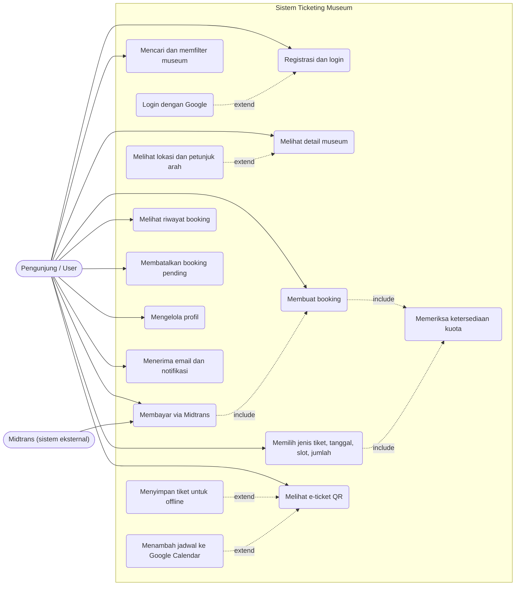
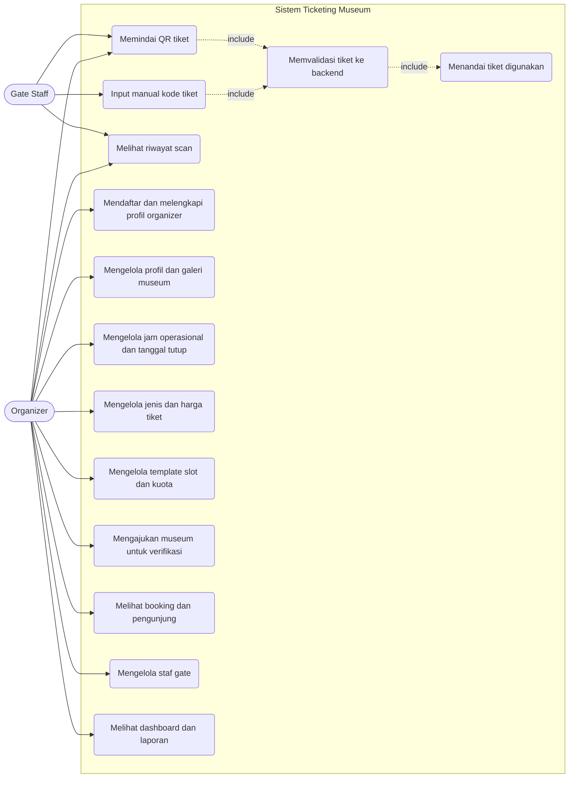
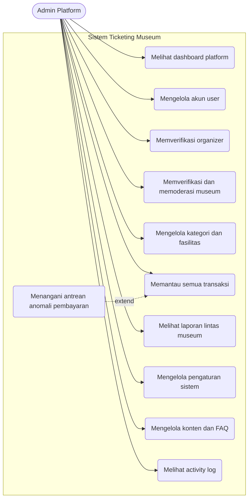
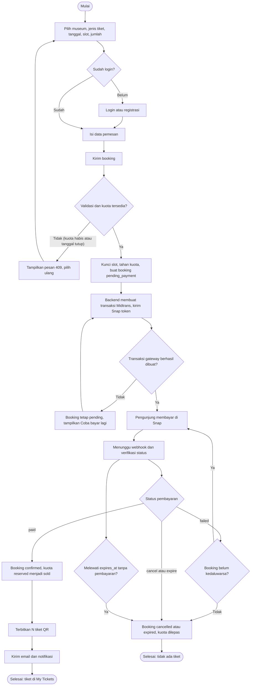
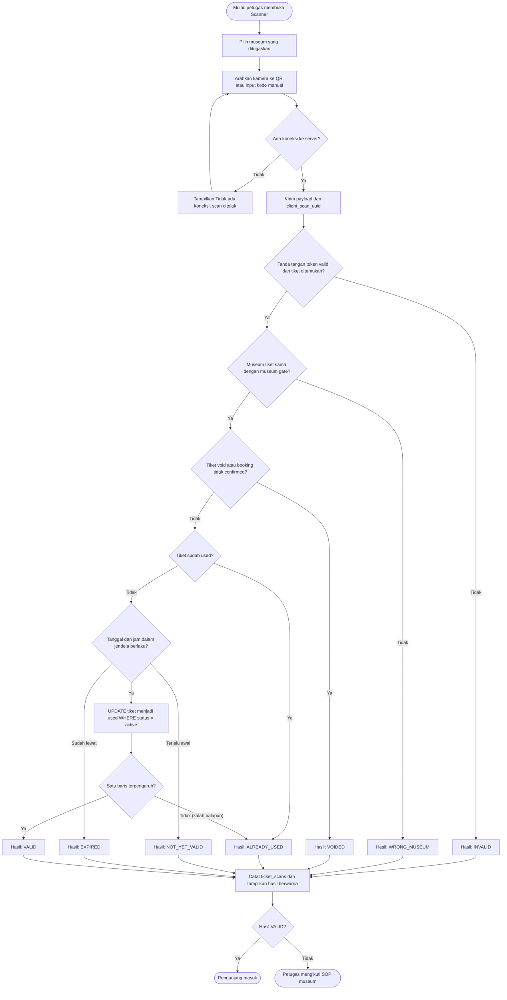
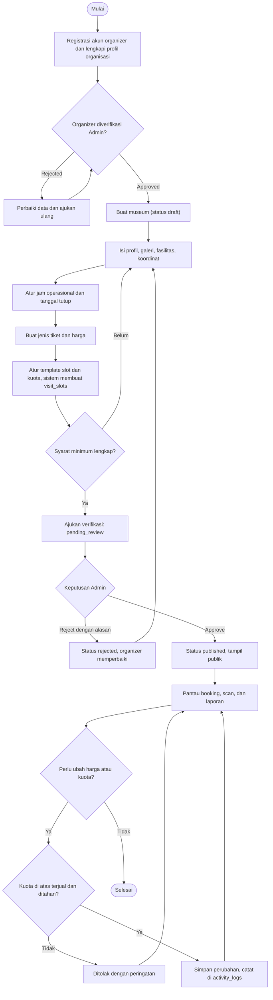
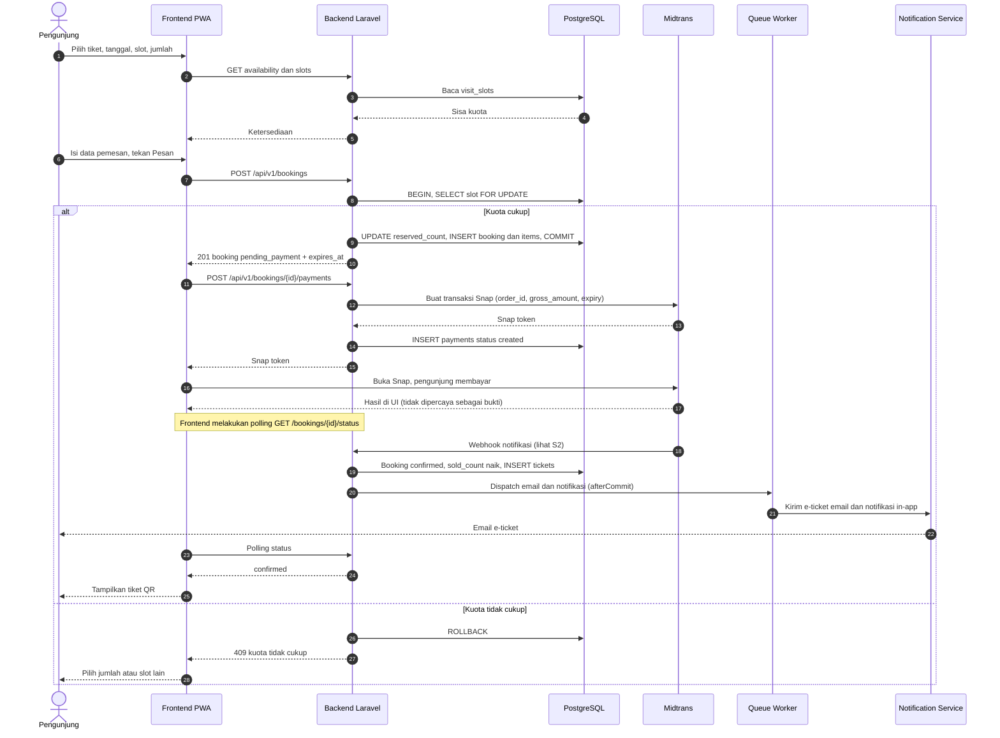
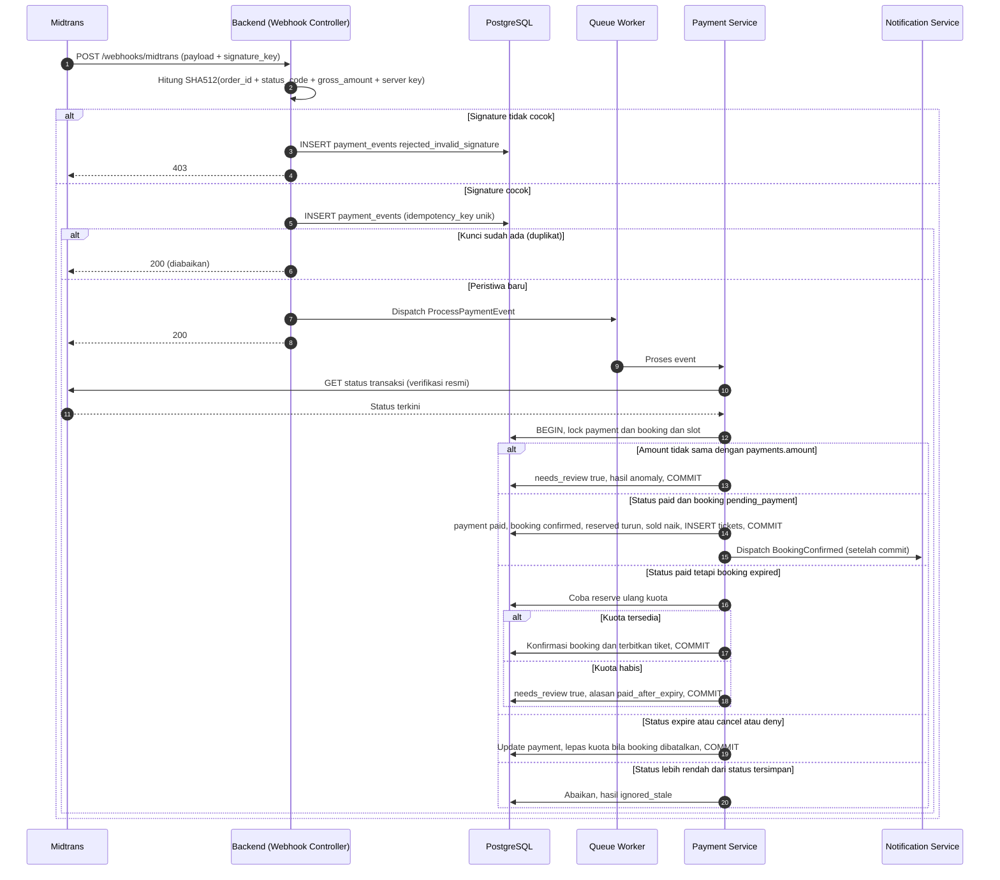
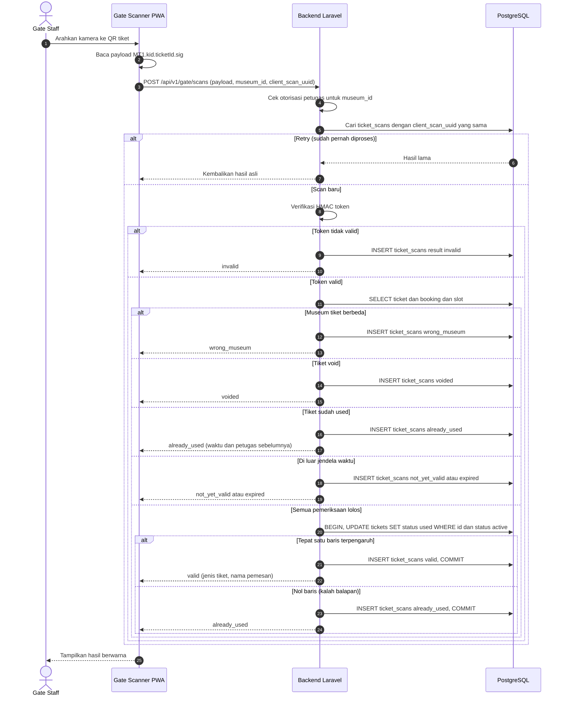
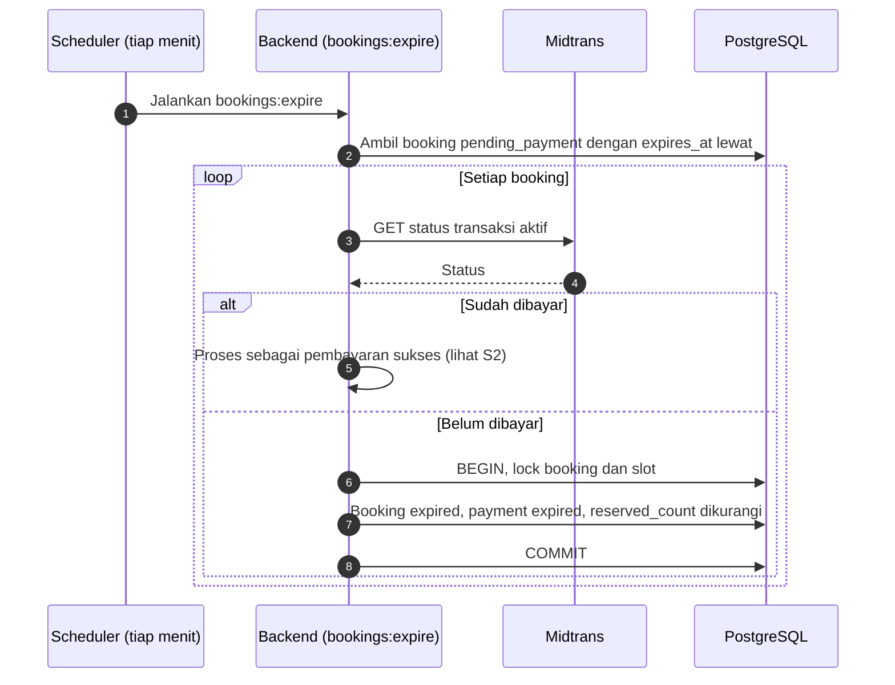

# UML dan Diagram Alur Proses

Dokumen turunan dari `SYSTEM_DESIGN.md` (§11–§13). Seluruh diagram memakai **Mermaid**. Nama status, tabel, dan endpoint identik dengan dokumen lain.

> **Catatan keterbatasan Mermaid:** Mermaid tidak memiliki notasi *use case* UML bawaan. Use case digambar dengan `flowchart`: aktor = bentuk stadium `([ ])`, use case = bentuk bulat `( )`, relasi `include`/`extend` = panah putus-putus berlabel. Maknanya setara dengan use case UML; hanya bentuk visualnya yang berbeda. *Activity diagram* digambar dengan `flowchart` (keputusan = belah ketupat). Diagram state ada di `SYSTEM_DESIGN.md` §11.2.

---

## A. Use Case Diagram

### A.1 Pengunjung (User)

### A.2 Gate Staff dan Organizer

### A.3 Admin Platform

---

## B. Activity Diagram

### A1. Pemesanan dan pembayaran tiket

### A2. Validasi dan scan QR di gerbang

### A3. Pengelolaan dan publikasi museum oleh organizer

---

## C. Sequence Diagram

### S1. User melakukan booking sampai e-ticket diterbitkan

### S2. Payment gateway mengirim callback/webhook

### S3. Gate staff melakukan scan dan validasi tiket

### S4. Expire booking otomatis dan pengembalian kuota

